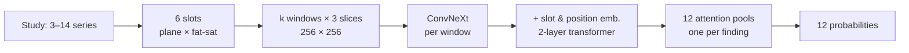

# RSNA knee MRI: experiments with a reader built on report-derived labels

My entry to Kaggle's [RSNA Knee Abnormality Detection](https://www.kaggle.com/competitions/rsna-knee-abnormality-detection) competition (October 2026). Each study is a knee MRI; the task is 12 probabilities (ligament and meniscal tears, osteoarthritis by compartment, effusion, synovitis, Baker's cyst, contusion, fracture), scored by macro ROC AUC on about 1,300 hidden studies. Only 58 of the 4,407 training studies have expert labels. The rest come with radiology reports, so every training target is something the competitor builds from the reports.

**Read the full write-up: [report/writeup.md](report/writeup.md).** It covers the rebuilt pipeline, the repeatability estimate and decision rule, every adopted and rejected change with intervals, the distillation experiment, three negative blending results, and the threats to validity.

## Results in brief

- **Final standing.** 2,432nd of 6,425 teams on the private leaderboard (top 38%), private 0.936 (public 0.950), from 11 submissions and about 67 Kaggle T4 GPU-hours. Provisional: Kaggle and RSNA had not yet verified the winners when I wrote this.
- **Most training tweaks were inconclusive.** Spread across four baseline runs (two seeds and two epoch counts) on one fold is 0.0014 AUC (SD). Epochs, resolution, more windows and a larger backbone alone all landed inside ±0.004. Mirror augmentation helped at 14 epochs (+0.0040) and hurt at 10, so a single-length study would have reached the wrong answer.
- **Ensembling across backbones was reliable.** On fold 0, 2 Tiny + 2 Small beat 4 Tiny by +0.0032. Across five folds, 10 mixed models beat 5 Tiny models by +0.0052; that comparison also increases ensemble size. The ten-model ensemble scored 0.935 public / 0.921 private.
- **Teacher-derived targets gave the largest gain.** Replacing half of each target with a calibrated prediction from a stronger public model raised a two-seed, single-fold student by +0.0093 out-of-fold and +0.0108 on the expert set. On the leaderboard that is +0.014 public and +0.016 private, more than the ten-model ensemble.
- **Blending with a stronger model showed nothing.** Three pre-specified rank blends, with two partners, each scored exactly the partner's own public score.
- **A fold-assignment bug inflated held-out AUC by about 0.04.** It came from the tie order of an `argsort` that differs between CPUs; a gate on "held-out AUC too close to training AUC" caught it.

## How the pipeline works



- **The reader is not mine.** The 2.5D ConvNeXt reader, its preprocessing and the v0 label recipe are goodpjw2008's (Apache-2.0, see `src/rsna_knee/reader/NOTICE`). I packaged it with configurable paths and devices, preserved the core architecture, and added experiment options plus deterministic preprocessing and fold fixes.
- **Reproducibility in the development environment was the contribution.** DICOMs are decoded once into a byte-identical 384-px cache, folds come from an explicit stable-sort rule, and one evaluation harness saves per-checkpoint logits so ensembles can be recombined offline. The public release does not include the per-run records needed to rerun every experiment; [REPRODUCING.md](REPRODUCING.md) states the boundary.
- **Offline uncertainty is explicit.** Key offline comparisons use paired study bootstraps and two seeds per arm; the extra-window experiment uses one seed. Leaderboard differences have no intervals. Gold58 was excluded from training but used as a validation gate.

## Quick start

```bash
cd rsna-knee
uv sync --locked --all-extras                       # Python >= 3.11; tested with 3.12
uv run pytest -q                           # 61 passed, 1 skipped (the skip needs the competition DICOMs)
uv run python report/make_figures.py       # figures 2–5 from report/data/*.csv

# bookkeeping used throughout the project
uv run python scripts/log_experiment.py <experiment>/metrics.json   # the only writer of experiments/results.csv
uv run python scripts/compare.py --help                             # paired comparison and adopt/reject decision
```

Training, evaluation and inference need the competition data and the reader's public checkpoints, neither of which is redistributed here. With them in `data/raw/` and `models/convnext_reader/`:

```bash
uv run python -m rsna_knee.reader.infer --device mps --amp none --ckpts models/convnext_reader/cnxt_v0_fold0.pt models/convnext_reader/cnxt_v0_fold1.pt models/convnext_reader/cnxt_v0_fold2.pt
```

The baseline verifier additionally needs an independently generated reference prediction CSV (`--reference`); it is not a fresh-checkout smoke test. See [REPRODUCING.md](REPRODUCING.md) for the training recipe, artifact requirements, and validation limits.

Use `--device cpu` without MPS or CUDA. Set `RK_DATA`, `RK_WORK`, `RK_RUNS` and `RK_EXT` to move the data, working, checkpoint and external-label roots. The Kaggle workflow (private code dataset, kernels, pull and wait) is in [kaggle/README.md](kaggle/README.md); it needs `~/.kaggle` credentials for the `wangshu` account.

## Layout

| Path | Contents |
|---|---|
| `src/rsna_knee/reader/` | Packaged reader: model, preprocessing, cache, labels, training, inference, out-of-fold evaluation |
| `src/rsna_knee/` | `metrics.py` (macro AUC, paired bootstrap, rank mean), `evaluation.py` (harness, inference configs), `training.py` |
| `scripts/` | Stage drivers `s1.py`–`s6.py`, `compare.py`, `build_distill_labels.py`, `kx.py` (Kaggle tooling), `log_experiment.py`, kernel builders, EDA |
| `kaggle/` | Kernel definitions (`kernel.json`, source, config) for cache, labels, eval, train, teacher and submission kernels |
| `tests/` | Metrics, bootstrap, evaluation harness, cache, label mixing, experiment log, Kaggle tooling |
| `experiments/` | `results.csv` (run summaries), final picks, leaderboard snapshot |
| `report/` | The write-up, its figures, the CSVs behind them, and `make_figures.py` |

## What is not here

- **Data and weights.** The competition data, the 110 GB preprocessing cache and the model checkpoints are not redistributed.
- **Per-run records.** The per-run directories under `experiments/` (predictions, logits, configs; about 60 MB) and the planning documents stay in my private development repository. `experiments/results.csv` and the CSVs in `report/data/` carry the numbers the write-up uses.
- **Generated kernels that embed other authors' notebooks.** `kaggle/{teacher,teacher-s6,submit-blend,submit-blend-s6}/kernel.py` wrap public notebooks by nartaa and heliosli (the S6 weights are CC BY-NC 4.0). The builders in `scripts/build_*_kernel.py` regenerate them from locally downloaded public notebook sources; they do not download those sources themselves.
