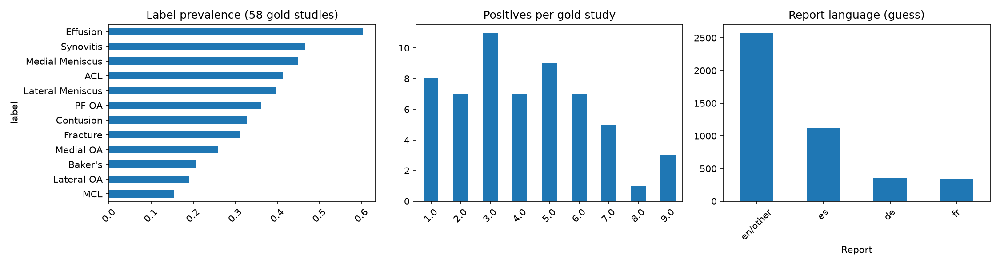
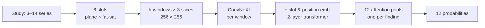
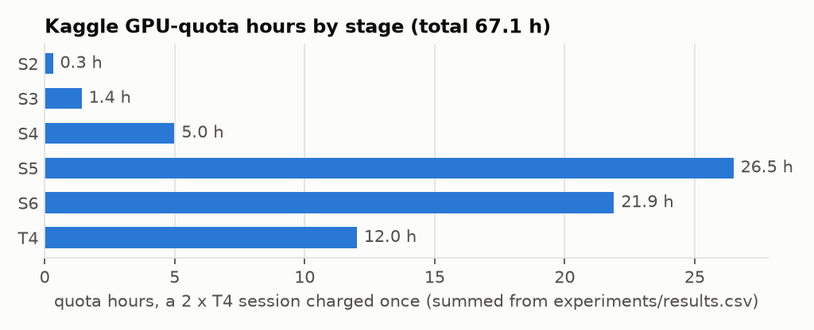
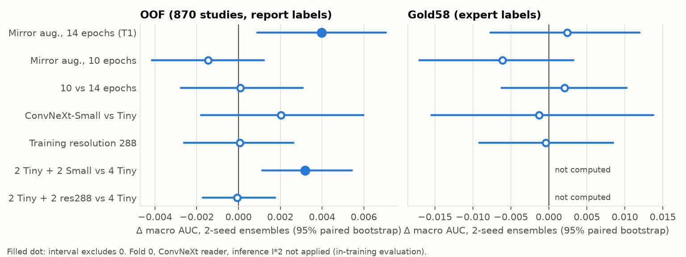
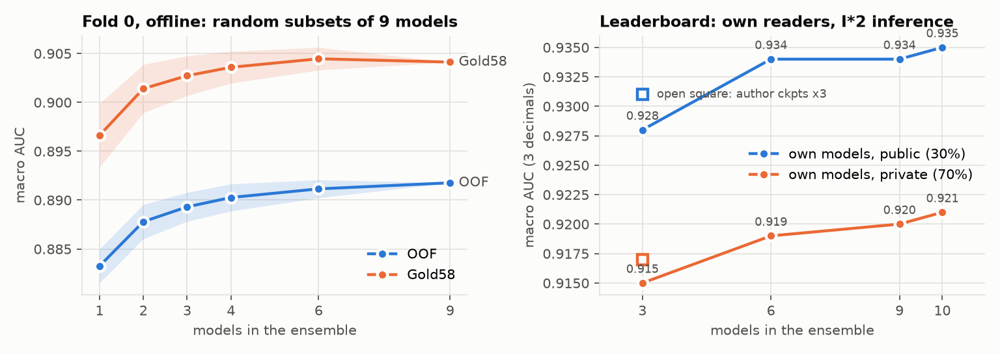
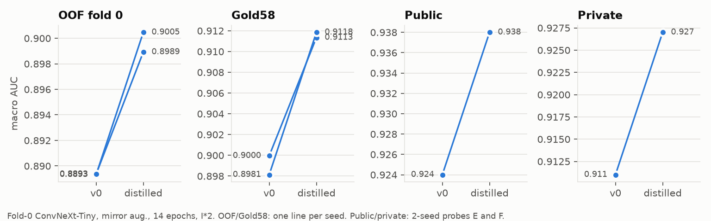

# Improving a Knee-MRI Reader with Teacher-Derived Targets: RSNA 2026

**Wangshu Pang** · October 2026

*A case study from two weeks, 11 submissions and about 67 GPU-hours on the Kaggle "RSNA Knee Abnormality Detection" competition*

> **Final version, 2026-10-25.** Submissions closed on 22 October; private scores are from the leaderboard as shown on 25 October. Kaggle and RSNA still have to verify the winning teams before the results are official (winners are due in November), so the rank below may still move slightly.

---

## Abstract

The RSNA 2026 knee challenge asks for the probability of 12 abnormalities (ligament tears, meniscal tears, osteoarthritis by compartment, effusion, synovitis, Baker's cyst, contusion, fracture) in each knee MRI study. It is scored by macro ROC AUC on about 1,300 hidden studies. It is a code competition: inference must run in a Kaggle notebook with no internet, in under 9 hours. The training set is unusual. Of 4,407 studies only 58 carry expert labels. The other 4,349 come with free-text radiology reports in several languages and no labels at all, so every training target is something the competitor builds from the reports.

I did not try to win. I took an open, trainable baseline (a 2.5D ConvNeXt reader with multiple-instance attention pooling, public score 0.929), rebuilt its pipeline so that, within my development environment, every run could be reproduced and compared, and used my Kaggle GPU quota on controlled experiments. The main training-side comparisons use two seeds and a paired bootstrap; the extra-window experiment used one seed. The 58 expert-labelled studies were excluded from student training, but their scores were monitored and used as a non-degradation gate (§5.3). They are a small validation set, not an untouched test set.

The experiments produced three groups of findings.

**(1) Most training tweaks were inconclusive; ensembling across backbones helped.** Spread across four baseline runs with two seeds and two epoch counts on one fold is 0.0014 AUC (SD); I treated single-seed differences under about 0.003 as inconclusive. Most training tweaks I tried (epochs, input resolution, more windows per slot, a larger backbone on its own) landed inside ±0.004. The one adopted tweak, anatomical mirroring during training, helped at 14 epochs (+0.0040 [+0.0009, +0.0071], 4/4 seed pairs) and hurt at 10 (−0.0015), so a study of either length alone would have reached the wrong conclusion. Mixing ConvNeXt-Tiny with ConvNeXt-Small models gained +0.0032 over the same number of Tiny models on fold 0. Across five folds, ten mixed models gained +0.0052 over five Tiny models, which also increases ensemble size. The final ten-model ensemble scored 0.8964 out-of-fold and **0.935 public / 0.921 private**, against 0.929 public for the baseline's own checkpoints.

**(2) Teacher-derived targets produced the largest measured gain.** Replacing half of each training target with a calibrated prediction from a stronger public model (a ConvNeXt-Small trained without external data, public 0.950) raised a two-seed, single-fold student by **+0.0093 [+0.0066, +0.0122] out-of-fold and +0.0108 [+0.0004, +0.0214] on the expert set**, winning 4/4 seed pairs. On the leaderboard the same two students scored **0.938 against 0.924 public and 0.927 against 0.911 private** for the identical recipe on the original labels. That is +0.014 public and +0.016 private, more than any other change in the project and more than the ten-model ensemble, from two models trained on one fold.

**(3) Blending a weaker model into a stronger public one did nothing visible.** Three pre-specified blends, rank(0.7 · rank(strong) + 0.3 · rank(mine)), with two different strong partners and two strengths of my ensemble, all scored exactly the partner's own public score (0.949 = 0.949, 0.950 = 0.950, 0.950 = 0.950). I report them as negative results.

**Final standing: 2,432nd of 6,425 teams on the private leaderboard (top 38%)**, with private 0.936 (public 0.950, 2,493rd). That is inside the 30–50% band I aimed for. The two final picks were the no-OAI blend ②′ and the distilled two-model reader (§6.8). The private scores of all 11 submissions keep the order of the public ones among my own readers, and the distillation gain held on the 70% of the test set the public board does not show.

---

## 1. Introduction

Medical imaging competitions often look like vision problems and turn out to be label problems. This one says so in its data: 58 studies with expert labels and 4,349 with nothing but a report. Whatever a model learns, it learns from targets someone extracted from those reports, and the hidden test set is labelled by expert readers looking at images, not at reports.

I joined on 7 October with two weeks left and a different aim from most entrants. These competition write-ups are portfolio pieces. I wanted a base I could develop on quickly and a set of experiments whose results I could explain and stand behind, and I was content with a mid-table rank (30–50%). Two consequences shaped the project:

1. **A trainable base instead of the strongest public notebook.** On 8 October the strongest public model (a CoAtNet-384, public 0.949) had private training code and was trained with an external dataset. The strongest open pipeline with training code was a 2.5D ConvNeXt reader at 0.929. I took the latter.
2. **Measurement before improvement.** I specified the metrics and adoption rule, then estimated repeatability from the baseline runs before interpreting later comparisons (§5). Run summaries are indexed in `experiments/results.csv`; figure data are in `report/data/`, and the final leaderboard snapshot is in `experiments/final-leaderboard.json`. Per-run predictions and detailed analyses remain in the development repository.

The work ran in stages S0–S7, each with acceptance gates written before it started. An AI coding agent executed the stages: code, Kaggle jobs, evaluations and records. I approved each stage, the final configuration and every decision that changed scope (see Acknowledgements).

**Contributions.**

- A reproducible rebuild of the public ConvNeXt reader (§3): a byte-identical preprocessing cache across machines, explicit fold assignment, a single evaluation harness that saves logits so that ensembles can be recombined without a GPU, and private Kaggle kernels for training, evaluation, teacher inference and submission.
- A measured run-to-run repeatability estimate and a decision protocol for training-side claims on a single fold (§5), including a fold-assignment bug that inflated held-out AUC by about 0.04.
- A complete set of inference-side and training-side ablations with effect sizes and intervals, adopted and rejected (§6.1–6.3).
- A distillation result (§6.5): a controlled two-seed experiment on fold 0 and a matched public-leaderboard comparison, with an account of why the out-of-fold gain may be optimistic.
- Three negative blending results and what they say about combining a 0.935 reader with a 0.950 model (§6.6).

---

## 2. The problem

### 2.1 Task and data

- **Input.** One study per knee: 3 to 14 MRI series (median 5), about 35 slices each, in sagittal, coronal and axial planes, with and without fat suppression. Per-series metadata gives the plane and whether the sequence is fluid-sensitive and fat-suppressed.
- **Output.** For each study, 12 probabilities: ACL, MCL, medial meniscus, lateral meniscus, medial OA, lateral OA, patellofemoral OA, effusion, synovitis, Baker's cyst, contusion, fracture.
- **Metric.** Macro ROC AUC over the 12 findings.
- **Training data.** 4,407 studies (24,371 series). A study's label row is either all 12 filled or all blank. A blank row means *unlabelled*, not negative. Only 58 rows are filled ("Gold58"); prevalence among them ranges from 16% (MCL) to 60% (effusion). All 4,407 studies have a report, in English, Spanish, German, French and other languages.
- **Test data.** 3 visible studies; about 1,300 hidden. The public leaderboard scores 30% of the hidden set and shows three decimals.



**Figure 1.** Label prevalence and positive findings per Gold58 study, plus heuristic language estimates for the reports.

### 2.2 Facts that shaped the design

**Table 1.** Properties of the competition and their consequences.

| Property | Consequence |
|---|---|
| 58 expert-labelled studies; 4,349 with reports only. | Training targets are report-derived soft labels (§3.3). Gold58 is the only measure of agreement with expert readers, and it is small: every Δ on it has a 95% interval of about ±0.01–0.015. |
| Hidden test labels come from image readers, not reports. | Out-of-fold AUC against report labels (M_oof) measures agreement with the reports. A change can raise it without helping on the test set, which matters most for label changes (§6.5). |
| Code competition, ≤ 9 h, no internet; ~1,300 hidden studies. | Inference cost is a constraint. Every inference change was timed and extrapolated to 1,300 studies × 1.5 with a 2 h gate. |
| The training archive is about 265 GB compressed; my laptop could not hold it. | All training and evaluation ran on Kaggle (2 × T4 per session, 30 GPU-hours per week). Preprocessing was cached once into seven private datasets (110 GB). |
| Public scores show three decimals, and the same notebook rerun gave 0.944, 0.944 and 0.943. | I treated public differences below about 0.003 as inconclusive. The leaderboard was used for confirmation, never for tuning. |
| Strong public models used OAI, an external knee-MRI dataset that requires registration. | I kept my own models free of external data, and used a model trained without OAI as the distillation teacher (§6.5). |

### 2.3 Where the leaderboard was

The public leaderboard moved fast. On 8 October the baseline stack notebook (0.944) ranked 984 of 5,516. Bronze sat near 0.949 and hundreds of teams tied at 0.950. By 15 October public blends of newly released models reached 0.956–0.958, and about 940 teams tied at 0.956. Community analyses noted that every visible jump came from a newly published trained model, not from reweighting existing ones. My own readers (0.924–0.938) sit well below the forked blends that fill the top half.

At the close (6,425 teams) the public board read 0.970 at the top, 0.957 at the 30th percentile and 0.942 at the median. The private board was lower everywhere: 0.960 at the top, 0.942 at the 30th percentile, 0.925 at the median. The bronze (top 10%) and silver (top 5%) cutoffs fell at about 0.942 and 0.943, and **1,322 teams tied at exactly 0.942**, mostly teams whose public best was the 0.958 public fork. A 30–50% finish meant a private score between 0.925 and 0.942.

---

## 3. System

### 3.1 The base: a 2.5D ConvNeXt reader

The base is goodpjw2008's public "2.5D ConvNeXt reader" (Apache-2.0). I packaged its core architecture and added deterministic preprocessing fixes, stable folds and configurable experiment options (`src/rsna_knee/reader/`).

- **Slots.** Each series is mapped to one of six slots: three planes × fat-suppressed or not. When a study has several candidate series for a slot, the one with the most slices is used.
- **Windows.** From each slot, k windows of three adjacent slices are taken at evenly spaced positions (k = 8 in training with jitter, k = 12 at evaluation). Each window is a 3-channel image at 256 × 256.
- **Encoder.** An ImageNet-22k pretrained ConvNeXt-Tiny encodes each window to one feature vector.
- **Study head.** Window features are projected to 384 dimensions, tagged with a slot embedding and a slice-position embedding, passed through a 2-layer transformer over all windows of the study, and pooled by one attention head per finding (multiple-instance learning: the model decides which windows matter for which finding).
- **Training.** Soft-target BCE, AdamW (lr 1e-4 backbone, 5e-4 head, weight decay 0.02), batch 8, 14 epochs with cosine decay, EMA 0.998. On a T4 the batch needs gradient checkpointing. One fold took 9.1 hours of wall-clock time with the base's per-epoch evaluation, and 4.2–4.9 hours for the 14-epoch Tiny models of C\* with evaluation only at the end.



### 3.2 Pipeline

- **Cache.** DICOMs were decoded once to 384-px NPY volumes in seven study-sharded private Kaggle datasets (24,371 training series, 0 failures). The first version differed from a local run by 1 grey level in 44 voxels, from float32 interpolation; switching to float64 interpolation made the 15 test series byte-identical between Kaggle and my laptop.
- **Labels and folds.** A label kernel writes the soft labels and the fold table with a pinned SHA-256 (§3.3, §5.4).
- **Evaluation harness.** One kernel (`rsna-knee-eval`) runs any list of checkpoints with any inference configuration over the held-out folds and Gold58 and saves per-checkpoint logits. Ensembles and alternative fold tables are then recombined offline.
- **Training kernel.** Runs a list of jobs on the two T4s in parallel, resumes from a state file, and writes checkpoints to a private dataset.
- **Submission kernels.** `submit-own` (my reader only) and two blend kernels built from public notebooks with pinned Docker images. Every submission was first run as a commit run on the 3 visible studies.

### 3.3 Training labels (v0)

The v0 recipe averages the available per-finding numeric targets from four public report-label tables, then clips the result to [0.01, 0.99] (`make_labels.py`). The script also contains a grade-to-probability mapping for an optional own-label v1 path; that mapping is not applied to the four v0 input tables. Against Gold58 these soft labels reach 0.8958 macro AUC. This measures ranking agreement, not a classification error rate or a bound on model performance (§6.5). Gold58 rows get fold = −1 and are excluded from student training and monitored for validation.

---

## 4. Development timeline

**Table 2.** Steps, dates and outcomes. GPU-hours are Kaggle GPU-quota hours as recorded in `experiments/results.csv`: a 2 × T4 session is charged once, and two jobs running in parallel in one session each record half of it.

| Step | Dates | Content | Outcome | GPU h |
|---|---|---|---|---|
| S0–S1 | 10/8 | Packaging, logging, cache, labels | Local and Kaggle outputs match; 110 GB cache | 0 |
| S2 | 10/8 | Evaluation harness, baseline checkpoints | M_oof 0.8882, M_gold 0.9105; fold bug found and fixed (§5.4) | 0.3 |
| S3 | 10/8–9 | Inference ablations | I\*₂ adopted (+0.0034); public 0.931 | 1.4 |
| S4 | 10/9 | Reproduce fold 0 on T4 | OOF reproduced (−0.0018); Gold58 0.014 low, accepted | 5.0 |
| S5 | 10/9–10 | Training ablations, 2 seeds per arm (1 for extra windows) | Mirror at 14 ep adopted; others rejected; ensembling dominates | 26.5 |
| S6 | 10/10–17 | Final ensemble C\* (5 folds × 2 backbones) | OOF 0.8964; public 0.935 | 21.8 |
| T4 | 10/10–18 | Distillation from a stronger public model | Two teachers; +0.0093 OOF, +0.0108 Gold58, public 0.938 vs 0.924 | 12.0 |
| Blends | 10/15–19 | rank(0.7 rank(strong) + 0.3 rank(mine)), three times | No visible gain | 0.1 |



**Figure 2.** Kaggle GPU-quota hours by stage, 67.1 in total. The blend probes (0.1 h) are counted under S6.

---

## 5. Evaluation methodology

### 5.1 Metrics

- **M_oof** — macro AUC on held-out folds against the v0 report labels binarised at 0.5. About 870 studies per fold, so it resolves small differences, but it measures agreement with the reports.
- **M_gold** — macro AUC on Gold58 against expert labels. Excluded from student training but used as a non-degradation gate, so not independent of selection. Some public partners or teachers may also have been selected on it.
- **Public** — 30% of the hidden set, three decimals, used for confirmation only.

### 5.2 Paired bootstrap and run-to-run repeatability

Offline comparisons use a paired bootstrap over studies (2,000 resamples), with the observed AUC difference and a percentile 95% CI. P(Δ > 0) denotes the fraction of bootstrap draws with a positive difference, not a frequentist p-value. Leaderboard differences have no intervals. That interval covers sampling of evaluation studies, not training randomness. To measure the latter I trained the base recipe four times on fold 0 with different seeds or epoch counts: OOF mean 0.8830, SD 0.0014, and pairs differed by up to 0.0027. This is a practical repeatability estimate that mixes seed and training-length effects, not a pure estimate of seed variance. I treated single-seed Δ_oof below about 0.003 as inconclusive. The main comparisons after the initial screening used two seeds per arm (the extra-window experiment remained single-seed) and were judged on (a) the paired bootstrap of the two-seed ensembles and (b) how many of the four cross-arm seed pairs went the same way.

### 5.3 Decision rule

Written down before the experiments:

- **Adopt** when the 95% CI of Δ_oof excludes zero and Δ_gold ≥ −0.01.
- **Pending** when the mean is positive but the CI crosses zero; retest only in combination.
- **Reject** otherwise.
- **Label changes** (distillation) bias M_oof, so they are judged on M_gold and on a matched public probe.
- **Public** differences under 0.002–0.003 were treated as inconclusive. No weight was ever tuned on the leaderboard; both blend weights were fixed before the first blend was scored.

### 5.4 A fold table that differed by CPU

The base groups studies into folds by report text with scikit-learn's `GroupKFold`. Nearly every report is unique, so nearly every group has one study and the assignment is decided by the tie order of an `argsort`. The older scikit-learn used NumPy's default sort, whose tie order differs between CPUs. My Kaggle label kernel and the baseline author's machine produced different fold tables for 2,789 of 4,349 studies. With the wrong table, the author's checkpoints scored 0.929–0.931 on their "held-out" fold, only 0.015 below their training folds. With the right table they scored 0.885–0.895. That is an inflation of about 0.04, larger than every effect in this report. The fix was an explicit stable-sort fold rule (`make_labels.stable_group_folds`), and the label kernel now reproduces the author's table byte for byte. A gate that failed when held-out AUC came out too close to training AUC caught it on the first evaluation.

---

## 6. Results

### 6.1 Inference-side ablations (S3)

All on the author's three fold checkpoints, held-out folds 0–2 and Gold58.

**Table 3.** Inference ablations. Cost is compute per study relative to the base.

| Change | Δ_oof [95% CI] | Δ_gold | Cost | Decision |
|---|---|---|---|---|
| k_eval 12 → 16 | +0.0006 [−0.0003, +0.0016] | −0.0018 | ×1.28 | pending |
| k_eval 12 → 24 | +0.0012 [+0.0004, +0.0022] | −0.0023 | ×1.80 | adopt |
| Anatomical mirror TTA | +0.0025 [+0.0016, +0.0034] | −0.0019 | ×1.79 | adopt |
| Average all candidate series per slot | +0.0007 [+0.0002, +0.0013] | −0.0013 | ×1.49 | adopt alone, dropped from I\*₂ |
| Inference resolution 256 → 288 | −0.0004 [−0.0017, +0.0007] | −0.0011 | ×1.23 | reject |
| Rank / logit averaging of folds | Gold58 only: +0.0007 / −0.0006 | — | 0 | not adopted |
| **I\*₂ = k_eval 24 + mirror TTA** | **+0.0034 [+0.0022, +0.0045]** | −0.0015 | ×1.05 wall-clock | **adopt** |

"Anatomical mirror" flips coronal and axial images left–right and reverses the sagittal slice order, which maps a left knee to a right knee. I\*₂ costs ×1.05 in wall-clock time because the mirrored pass is batched on the GPU. On the public leaderboard I\*₂ moved the author's checkpoints from 0.929 to 0.931, in the same direction as offline but within noise. Every inference gain was slightly negative on Gold58; none of those Δ_gold were distinguishable from zero.

### 6.2 Training-side ablations (S5)

All on fold 0 (3,479 training and 870 held-out studies), two seeds per arm except the extra-window experiment, in-training evaluation with the author's inference.



**Figure 3.** Training-side ablations: Δ and 95% CI of the two-seed ensemble against its control, on held-out fold 0 and Gold58.

**Table 4.** Training ablations.

| Comparison | Δ_oof [95% CI] | Δ_gold [95% CI] | Seed pairs won | Decision |
|---|---|---|---|---|
| Mirror augmentation p = 0.5, 14 epochs | **+0.0040 [+0.0009, +0.0071]** | +0.0024 [−0.0077, +0.0120] | 4/4 | adopt |
| Mirror augmentation p = 0.5, 10 epochs | −0.0015 [−0.0042, +0.0012] | −0.0061 [−0.0170, +0.0032] | 1/4 | reject |
| 10 vs 14 epochs | +0.0001 [−0.0028, +0.0031] | +0.0021 | 3/4 | no detectable difference, 28% cheaper |
| ConvNeXt-Small vs Tiny (10 ep) | +0.0020 [−0.0018, +0.0060] | −0.0013 | 3/4 | no single-model gain |
| Training resolution 288 vs 256 | +0.0001 [−0.0026, +0.0026] | −0.0004 | 2/4 | reject |
| Training windows k 8 → 12 (1 seed) | −0.0016 / +0.0004 | −0.0012 | — | reject (×1.55 time) |

Two results deserve comment.

**Mirroring interacts with training length.** Mirror augmentation is a natural idea here: knees come in two chiralities and the mirror is anatomically exact. A first single-seed run at 14 epochs suggested +0.003 to +0.005. The cheaper 10-epoch base then reversed the sign, and the two-seed replication at 14 epochs confirmed the gain at that length. This is consistent with the augmented model converging more slowly (higher training loss at equal epochs) and needing the longer schedule to profit; the experiment does not test that mechanism directly. With mirror TTA at inference the training-side gain roughly halves (+0.0017 under I\*₂, P(Δ > 0) = 0.82), since the two do part of the same job.

**A bigger backbone appears to help through diversity, not accuracy.** ConvNeXt-Small alone is no better than Tiny. But Small and Tiny disagree more (rank correlation of predictions 0.904 against 0.932 between two Tiny seeds), and 2 Tiny + 2 Small beat 4 Tiny by +0.0032 [+0.0011, +0.0054]. Resolution 288 made neither a better model nor a more different one (rank correlation 0.934; mixing it in: −0.0001).

### 6.3 Ensembling



**Figure 4.** Left: held-out fold 0 AUC against the number of models averaged, over the nine fold-0 models (random subsets). Right: public and private scores of my reader-only submissions against the number of fold models (3 = folds 0–2 Tiny, 6 = + Small, 9 = + the author's checkpoints, 10 = C\*); open squares are the author's three checkpoints.

On fold 0, averaging 1, 2, 4 and 9 models gives 0.8832, 0.8878, 0.8903 and 0.8918 out-of-fold. Going from one model to two is worth more than any training tweak in Table 4. The curve flattens fast: 4 → 9 models adds only +0.0015. The leaderboard shows the same shape on both splits: 3 → 6 models gained +0.006 public and +0.004 private, 6 → 10 only +0.001 and +0.002.

### 6.4 The final ensemble C\*

From S5, I chose C\* = 5 folds of Tiny with mirror augmentation at 14 epochs, plus 5 folds of Small with the author's recipe at 10 epochs, one model per fold and backbone, inferred with I\*₂. Both recipes had been compared with two seeds on fold 0 in S5. The ensemble was averaged in probability space. Folds 1–4 cost two sessions, 11.1 and 11.0 GPU-hours. Each new fold model landed within ±0.01 of the fold 0–2 models of its backbone.

**Table 5.** Own five-fold ensembles under I\*₂ cover all 4,349 weakly labelled studies. The author’s three-checkpoint reference uses base inference and only held-out folds 0–2; its OOF score is not on the same evaluation population.

| Ensemble | M_oof | M_gold |
|---|---|---|
| Author's 3 checkpoints, base inference | 0.8882 | 0.9105 |
| Tiny × 5 | 0.8911 | — |
| Small × 5 | 0.8907 | — |
| **C\* = Tiny × 5 + Small × 5** | **0.8964** | **0.9132** |
| C\* vs Tiny × 5 | +0.0052 [+0.0042, +0.0063] | +0.0043 (CI crosses 0) |

The estimated hidden-set inference time is 1.2 hours. C\* scored **0.935** public and **0.921** private (§6.7).

### 6.5 Distillation from a stronger public model (T4)

The S5 picture was clear: within this recipe and these labels, the remaining levers were worth thousandths. The v0 labels themselves agree with experts at only 0.8958 on Gold58, which is about as well as the trained models do. So the next lever was the labels.

**Teacher.** A model that is better than the reports at predicting expert labels can supply better targets. I first evaluated the strongest public model I had identified at the time, nartaa's CoAtNet-384 (public 0.949), and then switched teachers before training any students, for two reasons: it was trained with OAI, and its authors had used Gold58 to select it, so its Gold58 score was not clean. The replacement was nartaa's S6 ConvNeXt-Small (public 0.950 alone, trained without external data, Gold58 excluded from training, CC BY-NC 4.0). I wrapped its public inference code in a private kernel with its CoAtNet fallback removed, so that no OAI-trained component touched my training data. I ran it on the 3,537 studies a fold-0 student sees (3,479 training + Gold58): 0 failures, 4.98 GPU-hours, run in 500-study subprocess chunks after an earlier teacher run ran out of memory at about 870 studies.

**Labels.** For each finding, target = 0.5 · v0 + 0.5 · Platt(teacher), with the Platt scale and shift fitted against v0 on the weak studies. Held-out fold 0 studies keep v0, so M_oof is still measured against the original report labels. The S6 teacher came out nearly calibrated already (per-finding means within 0.06 of v0; the CoAtNet teacher's means were 0.42–0.49, far too high).

**Table 6.** Label quality on Gold58 (expert labels).

| Targets | Gold58 macro AUC |
|---|---|
| v0 report labels | 0.8958 |
| CoAtNet teacher (not clean) | 0.9229 |
| S6 ConvNeXt teacher | 0.9314 |
| labels_t4s = 0.5 v0 + 0.5 Platt(S6) | **0.9304** (+0.0346 [+0.0195, +0.0511] vs v0) |

**Students.** Two seeds of the adopted Tiny recipe (mirror, 14 epochs) on fold 0, trained on labels_t4s, against the same recipe and seeds on v0 (the S5-T1 runs), both evaluated with I\*₂.

**Table 7.** Distilled students against the matched control.

| | Control (v0 labels) | Students (labels_t4s) | Δ [95% CI] | Seed pairs |
|---|---|---|---|---|
| Single models, M_oof | 0.8893 / 0.8893 | 0.9005 / 0.8989 | | 4/4 |
| Single models, M_gold | 0.9000 / 0.8981 | 0.9113 / 0.9118 | | 4/4 |
| Two-seed ensemble, M_oof | 0.8927 | **0.9020** | **+0.0093 [+0.0066, +0.0122]** | |
| Two-seed ensemble, M_gold | 0.9036 | **0.9144** | **+0.0108 [+0.0004, +0.0214]**, P(Δ > 0) = 0.98 | |
| Public leaderboard (probes E, F) | 0.924 | **0.938** | **+0.014** | |
| Private leaderboard (probes E, F) | 0.911 | **0.927** | **+0.016** | |



**Figure 5.** Distilled students against the matched control. OOF and Gold58: one line per seed. Public and private: the two-seed probes E and F.

This is the largest effect in the project. Two distilled fold-0 models beat the ten-model C\* ensemble on both boards (0.938 vs 0.935 public, 0.927 vs 0.921 private). The gain on Gold58, the expert-labelled validation set, is as large as on M_oof, and the leaderboard gains are larger than both. The out-of-fold gain is spread across findings: all 12 per-finding AUCs rose (mean over the two seeds), most for ACL (+0.018), contusion (+0.017) and MCL (+0.016), least for the medial meniscus (+0.001). On Gold58, 8 of 12 rose, but with 58 studies the per-finding numbers are too noisy to read further. The baseline author had reported the opposite pattern for an earlier label change: out-of-fold AUC up from 0.888 to 0.903 with no public gain. Here the offline and online signals agree.

Is this my model or the teacher's? Both. The student is still a 2.5D Tiny reader at 0.938, well below its 0.950 teacher. What it took from the teacher is better targets on the same images. Section 7 places the result, and §8 lists what makes the out-of-fold number optimistic.

Per the decision I made on 10/17, T4 stays a separate experiment and is not merged into C\*. Distilling all ten C\* members would have needed another pair of training sessions (C\* folds 1–4 took 22 GPU-hours) plus teacher inference on the remaining folds, against 8.4 GPU-hours left in the week's quota. The two distilled students did become final pick ① (§6.8).

### 6.6 Blending with a stronger public model (negative)

I fixed one blend before any of it was scored: rank(0.7 · rank(strong public model) + 0.3 · rank(my ensemble)), averaged per finding in rank space, with my model taking over any study the partner fails to read.

**Table 8.** Blend probes. Partner scores alone are public; I did not submit the partners alone, so their private scores are unknown.

| Probe | Strong partner (alone, public) | My part (alone, public / private) | Blend, public | Blend, private |
|---|---|---|---|---|
| D | CoAtNet-384, OAI (0.949) | Tiny × 3 + Small × 3 (0.934 / 0.919) | 0.949 | 0.932 |
| G | S6 ConvNeXt-Small, no OAI (0.950) | Tiny × 3 + Small × 3 (0.934 / 0.919) | 0.950 | 0.936 |
| ②′ | S6 ConvNeXt-Small, no OAI (0.950) | C\* × 10 (0.935 / 0.921) | 0.950 | 0.936 |

Three blends, two partners, two strengths of my reader: no improvement at the displayed precision. Equal scores rounded to three decimals can hide differences approaching 0.001; they do not prove that the underlying predictions or AUCs are identical. The experiments do not establish why blending failed to produce a visible gain.

The private scores add one observation. G and ②′ are again identical (0.936), so the stronger C\* did not help on the larger split either. D, with the OAI-trained CoAtNet partner, came out 0.004 below the no-OAI blends on private while it was 0.001 below on public. Without the partners' standalone private scores I cannot say whether this is the partner or the blend, but it is consistent with the leaderboard as a whole: 122 teams finished with a public best of 0.950, and 66 of them ended at exactly 0.932 private.

### 6.7 Public and private leaderboard summary

**Table 9.** All submissions. Public = 30% of the hidden set, private = the other 70%. ① and ② mark the two final picks.

| Ref | Date | Submission | Models | Public | Private |
|---|---|---|---|---|---|
| 56935305 | 10/8 | Community stack, unchanged (safety) | — | 0.944 | 0.929 |
| 57016088 | 10/9 | Author ckpts × 3 + I\*₂ | 3 | 0.931 | 0.917 |
| 57093264 | 10/12 | A: own Tiny × 3 | 3 | 0.928 | 0.915 |
| 57093325 | 10/12 | B: own Tiny × 3 + Small × 3 | 6 | 0.934 | 0.919 |
| 57243528 | 10/15 | C: B + author × 3 | 9 | 0.934 | 0.920 |
| 57243726 | 10/15 | D: blend, CoAtNet partner | — | 0.949 | 0.932 |
| 57277048 | 10/16 | G: blend, S6 partner | — | 0.950 | 0.936 |
| 57319412 | 10/17 | **C\* × 10** | 10 | **0.935** | 0.921 |
| 57335130 | 10/18 | **F: distilled students × 2 (fold 0)** — final ① | 2 | **0.938** | 0.927 |
| 57376052 | 10/19 | E: control for F (v0 labels) | 2 | 0.924 | 0.911 |
| 57376196 | 10/19 | ②′: blend, S6 partner + C\* — final ② | — | 0.950 | 0.936 |

The public ladder of my own readers ran 0.928 (3 models) → 0.934 (6) → 0.934 (9) → 0.935 (10), then 0.938 with two distilled models. The private ladder ran 0.915 → 0.919 → 0.920 → 0.921, then 0.927.

### 6.8 Final picks and the private leaderboard

**Picks.** Kaggle reveals the private score of every submission after the close, so the two picks decide only the official rank, not what this report can show. I chose them on 21 October from public scores alone:

- **② = ②′**, the no-OAI blend rank(0.7 · rank(S6) + 0.3 · rank(C\*)): tied for my best public score, and free of external data. It carries the rank.
- **① = probe F**, the two distilled students: my best own reader on public and the main finding of this report. C\* × 10 was the more conservative choice, since it averages five folds instead of one.

Both picks turned out to be right on private: ②′ ties G as my best private score (0.936), and F is my best own reader there too (0.927 vs 0.921 for C\*). The provisional private rank, 2,432 of 6,425, comes from ②′. Ties on private are broken by submission time; 0.936 would rank 2,426–2,436 in any order.

**Public versus private.** Every submission lost 0.013–0.017 from public to private, and so did the whole board (top 0.970 → 0.960, median 0.942 → 0.925). These observations are consistent with a harder private split, but do not establish the cause of the shift. Absolute drops alone do not measure generalisation quality. What matters is whether comparisons held:

- **The order of my own readers was preserved**: E < A < author ckpts < B ≤ C < C\* < F on both splits (B and C tie at 0.934 on public).
- **The paired differences replicated** on the 70% split, which is about 2.3 times larger: distillation F − E +0.014 public / +0.016 private; second backbone B − A +0.006 / +0.004; final ensemble against the author's checkpoints C\* − S3 +0.004 / +0.004; distilled pair against C\* +0.003 / +0.006.
- **The safety baseline** (the unchanged community stack, 0.944 public) fell to 0.929, below both no-OAI blends (0.936) and the OAI blend (0.932).

My rank rose from 2,493 public to 2,432 private. The large ties explain most of the movement across the board: the 1,638 teams whose public best was 0.958 landed mostly on 0.942 (1,239 of them), and the median team moved 46 places.

---

## 7. Discussion: what moved the score

Approximate effect sizes in AUC units (evaluation populations differ: S3 uses folds 0–2, S5 and T4 use fold 0, and the final ensemble uses all five folds):

| Lever | Effect |
|---|---|
| Any single training tweak | within ±0.004 |
| Inference TTA (I\*₂) | +0.0034 |
| Second model of the same kind | about +0.005 |
| Second backbone at equal ensemble size (fold 0) | +0.0032 |
| Five Tiny + five Small vs five Tiny (all folds; size also increases) | +0.0052 |
| Better training labels (distillation) | +0.0093 (Gold58 +0.0108; public +0.014) |

The largest measured gain came from teacher-derived targets. The v0 labels score 0.896 against Gold58 and the trained models about 0.90–0.91, but these AUCs do not establish a label-imposed performance ceiling. Distillation transfers the teacher’s image knowledge as well as changing target calibration; this experiment does not isolate those mechanisms.

**The gap to the top.** The top of the public board (0.956+) was held by blends of models that (a) were trained with OAI, external data with its own labels, and (b) used heavier architectures (CoAtNet at 384 px) and, for the strongest ConvNeXt, an anatomy-localisation front end. My best reader is 0.012 below the best no-OAI single model I could inspect. I think the main parts of that gap are label quality and input resolution around the anatomy, not the ensemble. The cheapest test of the hypothesis would have been an S6-style localisation crop in front of my reader, keeping my labels fixed. I did not run it.

**What I would do next**, in order of expected value:

1. Distil all five folds of both backbones and re-run C\* on labels_t4s, estimating the student gain with a teacher that never saw the held-out fold (a fold-wise teacher).
2. Generate my own graded report labels (the base has a `v1` entry for an LLM extraction) and compare them with teacher labels on Gold58. That separates "better reports parsing" from "image knowledge from the teacher".
3. Site- or scanner-grouped folds, to check whether M_oof's absolute level is inflated by grouping on report text.

---

## 8. Threats to validity

- **The teacher saw the held-out fold.** The S6 teacher was trained on all weakly labelled studies, including my fold 0 held-out set, and its predictions on the training studies are in-sample (AUC 0.953 against binarised v0, versus 0.926 for the CoAtNet teacher). The students never saw fold 0 targets, but the teacher's knowledge of them may reach the students indirectly, so Δ_oof = +0.0093 may be optimistic. The hidden test set is independent of this fold overlap. Gold58 was excluded from teacher training according to its model card, but teacher selection and my validation gate limit its independence.
- **Teacher provenance limits the Gold58 evidence.** The S6 model card says Gold58 was excluded from training; it does not say whether Gold58 was used to select the model.
- **Gold58 is small.** 58 studies give intervals of ±0.01–0.015. It is a check of direction, not a ranking tool. Only the distillation Δ_gold excludes zero.
- **M_oof is agreement with reports.** Folds are grouped by report text, not by site or scanner, so absolute M_oof may be optimistic. Pairing reduces sampling variability but does not remove shared site or scanner bias, or guarantee that relative gains transfer to new sites.
- **Training ablations were run on fold 0 only.** The other folds were used to reproduce, not to re-test.
- **Two seeds reduce reliance on one lucky run; they neither rule out seed effects nor estimate training variability precisely.** The four cross-arm pairs share models and are not four independent replications. The reported intervals also do not correct for multiple comparisons or experiment selection.
- **The leaderboard shows three decimals.** On public (30%), three comparisons exceeded the 0.003 threshold: E vs F (+0.014), A vs B (+0.006) and C\* vs the author's checkpoints (+0.004). The private split (70%) replicated all three and kept the order of every own reader (§6.8), but it is still one test set: none of my private differences comes with an interval, and the 0.001-level steps (B → C → C\*) are not results.
- **One distillation experiment, one fold.** Probe F is two models on fold 0; the private gain is a replication on new test studies, not on new training data or a second teacher.
- **Reproduction gap on Gold58.** My fold-0 reproduction of the author's recipe matched on M_oof (−0.0018) but scored 0.014 lower on Gold58. Candidate causes are fp16 instead of the author's precision and 2 instead of 12 data-loader workers, which changes the augmentation stream. I accepted the gap and compared only my own runs with each other.

---

## 9. Lessons

1. **Measure repeatability before the first comparison.** Four base-recipe runs on one fold cost about 9 GPU-hours and decided how every later result was read. Without them a single 14-epoch mirror run could have been overgeneralised to the 10-epoch schedule, where the measured effect reverses.
2. **Gate on implausibly good results, not just bad ones.** The fold bug made everything look better. It was caught by a gate that failed when held-out AUC was too close to training AUC.
3. **When the targets are weak, work on the targets.** The target-changing experiment produced a larger measured gain than any individual training tweak.
4. **Fix blend weights before seeing a score.** It made the three null blends easy to read and report.
5. **Use the leaderboard to confirm, not to search.** I made 11 submissions: one unchanged community notebook as a safety baseline, and ten that each tested a hypothesis written down before it was scored. On the private split every one of the comparisons I had drawn from public kept its direction, which is consistent with the leaderboard never having been used to pick among near-equal variants.
6. **Treat the platform as part of the system.** Kaggle sessions that mount 24k cached files took about 9 minutes to start and hung when two started together. Running one GPU session at a time, plus a start watchdog, cost less than the hangs.

---

## 10. Conclusion

On a weakly supervised medical-imaging task with 58 expert labels, I rebuilt an open baseline into a pipeline that is reproducible within my development environment and measured what moves it. Most training-side tweaks were inconclusive; mirror augmentation at 14 epochs was the exception. Mixing backbones gave +0.0032 over the same number of Tiny models on fold 0, and the final ten-model ensemble scored 0.935 public (0.921 private) against 0.929 for the baseline checkpoints. Distilling half of each target from a stronger, external-data-free public model gave +0.009 out-of-fold, +0.011 on the expert set, +0.014 public and +0.016 private from just two models. Blending with stronger public models showed no visible gain, three times. The project finished 2,432nd of 6,425 (top 38%) on the private leaderboard. Within the tested recipe, improving targets through distillation was the most effective intervention.

---

## Acknowledgements and tooling

The reader architecture, preprocessing and v0 label recipe are goodpjw2008's (Apache-2.0). The distillation teacher and the blend partners are nartaa's published models (CC BY-NC 4.0 for the S6 ConvNeXt). The S6 inference code builds on heliosli's published pipeline. The data and the competition are RSNA's and Kaggle's.

Development used an AI coding agent (Claude Code) that wrote the code, ran the Kaggle jobs and evaluations and applied the acceptance gates written in advance. I set the goal and scope, approved each stage's direction, chose the final configuration and the teacher, and made the submission decisions.

## References

1. RSNA Knee Abnormality Detection, Kaggle, 2026. https://www.kaggle.com/competitions/rsna-knee-abnormality-detection
2. goodpjw2008. 2.5D ConvNeXt reader (code, checkpoints and v0 label recipe), Kaggle dataset `goodpjw2008/rsna-knee-2-5d-convnext-reader`, Apache-2.0.
3. nartaa. S6 ConvNeXt-Small weights, Kaggle dataset `nartaa/rsna-knee-s6fall-weights` (CC BY-NC 4.0), and inference notebook `nartaa/rsna-knee-s6fall-solo`.
4. nartaa. CoAtNet-384 SWA weights, Kaggle dataset `nartaa/rsna-knee-publication-swa-weights-20261007`.
5. heliosli. Published RSNA knee pipeline and weights, e.g. Kaggle dataset `heliosli/rsna-orthofoundation-fold0-epoch7-20261004`.
6. G. Hinton, O. Vinyals, J. Dean. Distilling the Knowledge in a Neural Network. arXiv:1503.02531, 2015.
7. M. Ilse, J. Tomczak, M. Welling. Attention-based Deep Multiple Instance Learning. ICML 2018.
8. Z. Liu, H. Mao, C.-Y. Wu, C. Feichtenhofer, T. Darrell, S. Xie. A ConvNet for the 2020s. CVPR 2022.
9. B. Efron, R. Tibshirani. An Introduction to the Bootstrap. Chapman & Hall, 1993.
10. J. Platt. Probabilistic Outputs for Support Vector Machines and Comparisons to Regularized Likelihood Methods. Advances in Large Margin Classifiers, 1999.

## Appendix A. Repository map

| Path | Contents |
|---|---|
| `src/rsna_knee/reader/` | Packaged reader: model, preprocessing, training, inference, labels (adapted, Apache-2.0) |
| `src/rsna_knee/metrics.py`, `evaluation.py`, `training.py` | Macro AUC, paired bootstrap, evaluation harness, training driver |
| `scripts/kx.py` | Render, push, poll and pull private Kaggle kernels and datasets |
| `scripts/s2.py`, `s5.py`, `s6.py`, `compare.py` | Per-stage evaluation, analysis and config generation |
| `scripts/build_distill_labels.py` | Platt-calibrated teacher mixing (§6.5) |
| `scripts/build_teacher_s6_kernel.py`, `build_blend*_kernel.py` | Teacher and blend kernels, built from locally downloaded public notebook sources |
| `scripts/log_experiment.py` | The only writer of `experiments/results.csv` and `log.md` |
| `kaggle/` | Kernel definitions: cache, labels, eval, train, teacher, submit-own, submit-blend |
| `experiments/` | `results.csv` (run summaries), `final-picks.md`, `final-leaderboard.json` |
| `report/` | This report, `make_figures.py`, and the CSVs behind the figures |
| `tests/` | 62 tests: metrics, bootstrap, evaluation harness, cache, label mixing, Kaggle tooling |

For runnable commands and the limits of this release, see [REPRODUCING.md](../REPRODUCING.md).

The per-run directories under `experiments/` (predictions, logits, configs; about 60 MB) and the model checkpoints stay in my private development repository. The four generated kernels that embed other authors' public notebooks (`teacher`, `teacher-s6`, `submit-blend`, `submit-blend-s6`) are not redistributed; their builders regenerate them.

## Appendix B. Reproducing the figures and tests

```bash
uv sync --locked --all-extras
uv run python report/make_figures.py   # reads report/data/*.csv, writes report/figures/*.png (figures 2–5)
uv run pytest -q                       # 61 passed, 1 skipped (the skip needs the competition DICOMs)
```

Figure 1 is written by `scripts/eda.py` from the competition metadata CSVs, which are not redistributed.

## Appendix C. Glossary

- **Gold58** — the 58 training studies with expert labels; excluded from student training; monitored for validation.
- **v0** — soft labels averaged from the numeric targets of four public LLM-derived report-label tables, clipped to [0.01, 0.99].
- **M_oof / M_gold** — macro AUC on held-out folds (report labels) / on Gold58 (expert labels).
- **I\*₂** — inference with 24 windows per slot and anatomical mirror TTA.
- **C\*** — final ensemble: 5 folds ConvNeXt-Tiny (mirror, 14 ep) + 5 folds ConvNeXt-Small (10 ep).
- **T4 / labels_t4s** — distillation experiment / its targets, 0.5 · v0 + 0.5 · Platt(S6 teacher).
- **Probe** — a public-leaderboard submission made to test one hypothesis.
