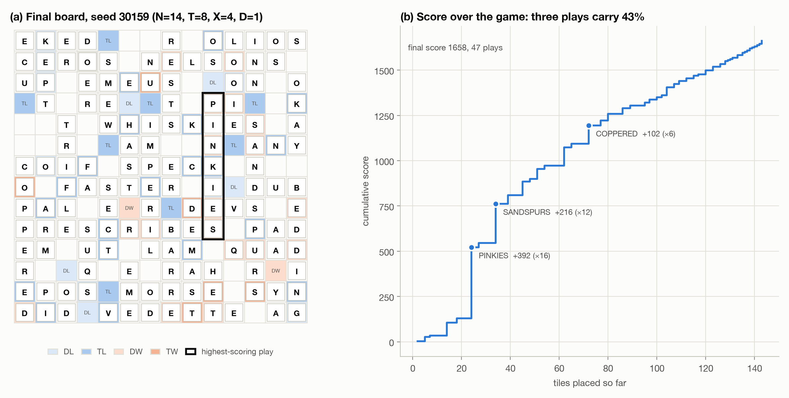
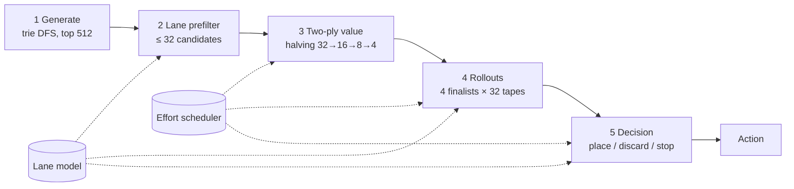

# WordGame: a search-and-decide solver for TopCoder Marathon Match 167

My entry to TopCoder's [Marathon Match 167](https://www.topcoder.com/challenges/0b11e0fd-3e2d-46dc-8f7b-27c9f49d63cb) (7–13 October 2026), a week-long optimization contest. It is a single-player Scrabble-like game. On an N×N board (N = 10–20) the player holds T = 5–9 tiles, sees the next X = 0–5 tiles of a random sequence of N² tiles, and each turn places a dictionary word or discards any subset of the hand for a D = 0–5 point penalty. Word multipliers stack (DW × TW = ×6), so a few plays dominate a game. Each game has 10 seconds, and the leaderboard rates each case against the best competitor on it.

**Read the full write-up: [report/writeup.md](report/writeup.md).** It covers the solver design, every shipped and rejected change with its measured effect, the evaluation methodology, a fresh 200-seed analysis of what the games look like, testable hypotheses about the gap to the leaders, and the architecture I would start from next time.



## Results in brief

- **Standing.** Final score **40.57, rank 41 of 79** on the 5,000-case final test (provisional 36.47). The provisional score went from 26.6 (greedy baseline) to a best reading of 37.0 over three days. The winners scored 86.6.
- **A ladder that flattened.** On 200 fresh seeds the final build scores 1.65× the greedy baseline: two-ply lookahead +24%, a rack-aware multiplier-lane prefilter +14%, a deterministic effort scheduler +9%, rollouts and a place/discard/stop decision +3%, fishing for lane letters +3% (stage gains from their historical validations). More width, samples and effort stopped helping, and the final build uses about a third of the 10 s limit.
- **Local and online disagreed at the margin.** Two builds that beat their parent by 2.9% locally (600 validation games; 5,000 release games that were also used for diagnosis) read 2.4% lower on the 100-case provisional board. Slow-machine, compiler and timeout hypotheses were tested and did not explain it.
- **The score is a few jackpots.** Over 200 fresh games, 66% of placed tiles earn under 10 points each and 17% of the score, while plays with a word-multiplier product of ×27 or more (1.5 per game) earn 48%. Almost the entire gain over the greedy baseline is in those plays. Points per consumed tile fall from 32 in the first quarter of the deck to 7 in the third, 35% of double/triple-word cells are spent in plays with a product of only ×2–3, and only 15% of the J/K/Q/X/Z tiles land in a ×9+ play.
- **My best guess at the gap is planning.** The winners' normalized score is 2.13× mine. The solver already fishes for target words but re-chooses its target every turn and gives multiplier cells no value of their own. Persistent targets with soft cell protection are the hypothesis I would test first; the write-up gives the experiment that would refute it.
- **Postscript: what the runner-up did.** The second-place write-up confirms the planning hypothesis and corrects my benchmark. Their jackpot words are longer than one move, with most letters placed beforehand. Against that ceiling (the product of the T largest word multipliers in a line, median ×81 on my seeds), my best play is a median ×27. On the 62 boards where the ceiling is ×243 or more, which carry 62% of my points, it is reached twice.

## How the solver works



- **Generation.** A trie walk with cross-check masks enumerates every legal placement with its exact score and keeps the best 512.
- **Lane prefilter.** Windows of up to T empty cells whose word-multiplier product is at least 4 get exact word lists. A candidate's key is its score plus the expected best lane play its leave can complete next turn. This finds the setup moves that open big multiplier plays.
- **Two-ply value with successive halving.** Q = score + E[best next score] + a board-potential term, on refills sampled from *common* streams so that candidates are compared on the same futures. The better half of the candidates gets each further sample.
- **Rollouts on shared tapes.** Four finalists play 4 more turns on 32 shared hypothetical tile sequences with a policy that fishes for lane letters. The rollout value is mixed half and half with Q.
- **Decision layer.** When there is no word, the play is weak, or a fishing target beats it, the placement is compared with up to 8 discard subsets and with stopping, on the same tapes.
- **Effort, not time.** Every stage spends predicted reference-machine nanoseconds computed from deterministic operation counts. The same seed gives the same game while the wall-clock safety guard remains inactive; load can change decisions when it engages.

## Quick start

```bash
cd tc_marathon_167
make build                 # Release build: build/WordGame (C++17, CMake 3.16+)
make test                  # 5 C++ unit-test suites + golden action traces (traces need tools/enable2k.txt)

# Play one game with the official tester (Java 11+; put tester.jar and enable2k.txt in tools/, see tools/README.md)
python3 scripts/run_tester.py --exe build/WordGame --seeds 1:10 --jobs 4

# The single source file TopCoder accepts
make bundle                # dist/WordGame.cpp and dist/WordGame.zip
python3 scripts/bundle.py --check   # also compiles the bundle and checks it plays like build/WordGame

# Regenerate figures from archived data in a dedicated Python environment
python3 -m venv build/report-venv
build/report-venv/bin/python -m pip install -r report/requirements.txt
build/report-venv/bin/python report/make_figures.py
```

The solver speaks the official protocol on standard input and output, so it can also be run directly under the tester:

```bash
cd tools && java -jar tester.jar -exec "../build/WordGame" -seed 1 -tl 10000
```

### Configurations

With no arguments the solver runs **O-01C**, the configuration the final submission was built from. Named presets reproduce the other submitted builds, and individual flags override any value:

| Command | Build |
|---|---|
| `build/WordGame` | O-01C (default): rollouts, fishing, decision layer, estimator fixes, dominated-STOP guard |
| `build/WordGame --preset o-01a` | O-01A (36.07 provisional) |
| `build/WordGame --preset int-01` | INT-01, the best provisional reading (37.04) |
| `build/WordGame --preset p2-03` | P2-03 (35.43): two-ply + lane prefilter + effort scheduler, no rollouts |
| `build/WordGame --preset p2-03 --no-sched` | P1-02 behaviour (fixed per-turn wall-clock slices) |
| `build/WordGame --preset p2-03 --no-lookahead` | Trie greedy (close to the baseline B0) |

The final submission was O-01C with one of six reduced time or effort budgets, equivalent to adding one of `--budget-ms 5000`, `--budget-ms 3000`, `--work-ms 2000 --discard-work-ms 667`, `--work-ms 1500 --discard-work-ms 500`, `--work-ms 1000 --discard-work-ms 333` or `--work-ms 700 --discard-work-ms 233`; the record does not say which. The tested reductions range from roughly 0.5% to 8.9% below O-01C locally (write-up §8.5). The default is the base configuration, not a verified reconstruction of the 40.57-point submission. `--diagnostics` writes one JSON line per turn to standard error.

## Layout

| Path | Contents |
|---|---|
| `src/` | The solver, one module per concern; `WordGame.cpp` is the unity translation unit that includes them all |
| `tests/` | C++ unit tests (brute-force generator oracle, simulation, rollouts, discards, fishing), the Java-free game driver `selfplay.py`, golden action traces |
| `scripts/bundle.py` | Inline the modules into the single submission file |
| `scripts/run_tester.py` | Run the official tester over a seed range, CSV out |
| `report/` | The write-up, its figures, the data behind them, `extract_runs.py` (tester runs → data) and `make_figures.py` (data → figures) |
| `tools/` | Where TopCoder's tester and dictionary go (not redistributed) |

The source is the O-01C code family, refactored after the match from one 2,300-line file into modules. The behavioural addition is `--preset`; its default matches the frozen O-01C base package, whose budget differs from the unidentified final online probe. Golden traces captured from the pre-refactor binary and from the submitted package, are checked by the test suite; a 200-seed comparison on the official tester made at the time found identical decisions (write-up §8.2). Tested with Apple clang 21 and OpenJDK 21 on macOS (arm64).

Where each historical number comes from, and what was re-checked after the match, is listed in [report/evidence.md](report/evidence.md). Re-run commands and exact configuration names are in the [reproduction appendix](report/writeup.md#appendix-b-reproducing-the-results).
