# Cashing the Multipliers: A Search-and-Decide Solver for TopCoder Marathon Match 167 (WordGame)

**Wangshu Pang** · October 2026

*A case study from three days of development on TopCoder Marathon Match 167, written in C++17*

---

## Abstract

WordGame is a single-player, Scrabble-like optimization game. On an N×N board (N = 10–20) a player holds T = 5–9 letter tiles, sees the next X = 0–5 tiles of an otherwise random sequence of N² tiles, and on each turn either places a dictionary word or discards any subset of the hand for a penalty of D = 0–5 points. Words score their letter values with double/triple letter and word multipliers, and word multipliers stack multiplicatively. There is no opponent, the whole game has a 10-second limit, and each test case is scored relative to the best competitor on it.

I built a C++ solver around one idea: every turn passes through a narrowing pipeline of increasingly expensive evaluations, and the pipeline is budgeted in *deterministic effort units* rather than wall-clock time. A trie move generator keeps the 512 best placements. A rack-aware "lane model" prefilters them to at most 32. A two-ply evaluation on common sampled refills halves them to 4. Four-step rollouts on 32 shared random tapes re-rank the finalists. A decision layer then compares the chosen placement with selective discards and stopping. Over three days the provisional score rose from 26.6 (greedy baseline) to 37.0, and the final submission scored **40.57 on the 5,000-case final test, rank 41 of 79**. The winners scored 86.6.

The work produced three groups of findings.

**(1) The ladder of improvements was real but flattened fast.** On 200 fresh seeds the final build scores 1.65× the greedy baseline. Two-ply lookahead (+24%) and the lane prefilter (+14%) delivered most of it. Every later stage added 1–9%, and each stage saturated: the two-ply evaluation at about 1.5 s of reference-machine effort per game, the full pipeline at the shipped 3 s, beyond which more effort did not help. The final build uses about a third of the time limit, and all six reduced-budget probes scored lower locally.

**(2) Local and online measurements disagreed at the margin.** Two builds that won clean local validations against their parent (+2.9% over 600 games, +2.9% over 5,000 games) read 2.4% *lower* than it on the 100-case provisional leaderboard, and the final submission read 1.4% lower. Slow-machine simulation, compiler variants and timing-guard experiments could not reproduce the drop. With no per-case online data the cause stays unknown, so I describe what was tested and what it rules out.

**(3) The score is a few jackpots, and the architecture does not plan for them.** A fresh analysis of the final build shows that 66% of placed tiles earn 17% of the points, that the best three plays carry a median 46% of a game, and that the points per tile fall from 32 in the first quarter of the deck to 7 in the third. The solver does cash the single best multiplier window on the board in most games. It loses value elsewhere: 35% of double/triple-word cells are spent in plays with a product of only ×2–3, and the high-value letters rarely land on multipliers. A solver that plans those jackpots explicitly, keeping the right letters and holding multiplier lanes open, is the most plausible explanation for the leaders' roughly 2× higher raw scores. Section 9 presents the evidence, and Section 10 sketches the architecture I would start from next time.

---

## 1. Introduction

TopCoder Marathon Matches are week-long optimization contests. Hidden test cases are generated at random, each submission runs on them under a time limit, and each case scores *YOUR / MAX*, where MAX is the best raw score any competitor's latest submission achieved on it. Match 167 ran from 7 to 13 October 2026, with 10 example cases, 100 provisional cases during the match and 5,000 cases in final testing.

I started late. The repository was created on 11 October at 01:19 PDT, and the first submission went in four minutes later. That left about 70 hours of the 7-day match. The time pressure shaped two choices that the rest of this report examines:

1. **Incremental search refinement over a redesign.** Each step took the previous build as a parent and added one evaluation stage, validated end to end.
2. **A heavy validation protocol.** Every candidate had a pre-registered set of gates, including paired statistics on fresh seeds, tail bounds, completion rates under stress and an equivalence check when switched off. That made every shipped step trustworthy, and it cost wall-clock time that a redesign would have needed.

This report is written in the same spirit as my [Marathon Match 166 write-up](../../tc_marathon_166/report/writeup.md). It is a case study in method as much as a leaderboard story, including the parts that did not work.

**Contributions.**

- A five-stage per-turn pipeline (§3) with deterministic effort accounting, common random numbers across candidates and action types, and an anytime guarantee: any stage can stop and return a complete, legal action.
- A record of every substantive change with its measured effect (§5–6): eight shipped and fifteen rejected, each measured end to end on the official tester.
- A measurement methodology (§7) built on paired geometric-mean ratios, three strategy seeds and pre-registered gates, with an honest account of where it failed to predict the leaderboard.
- A fresh 200-seed analysis of the final solutions (§8) and an inference about what the leaders did differently (§9), with a concrete redesign (§10).

---

## 2. The problem

### 2.1 Rules

- **Board and tiles.** An N×N grid, N ∈ [10, 20]. The game has exactly N² tiles, including the initial hand, drawn independently with probability proportional to each letter's frequency in the dictionary (enable2k filtered to words of length ≤ N, about 126k–173k words). There are no blanks.
- **Information.** The player holds T ∈ [5, 9] tiles and sees the next X ∈ [0, 5] tiles of the sequence. Nothing else about the future is known.
- **Actions.** Either `PLACE r c dir word`: a horizontal or vertical word that covers the start cell on the first move and reuses at least one board letter afterwards. Every perpendicular word it forms must also be in the dictionary. Or `DISCARD letters`: any subset of the hand, for a penalty of D ∈ [0, 5] points *per action*, regardless of how many tiles; discarded tiles are lost. Or `-1`, which ends the game.
- **Score.** For each word formed, (Σ letter values, with DL/TL applied to newly placed tiles) × (Π DW/TW multipliers under newly placed tiles). The main word and every new cross word score. Multipliers apply only on the turn a tile is first placed. Letter values follow Scrabble (Q and Z 10, J and X 8, K 5, and so on).
- **Bonus grid.** Each cell independently gets one of d/D/t/T with total probability B ∈ [0.1, 0.5]; the four weights are drawn from [0.2, 1] and normalized. B is not given to the solver, but the grid is.
- **Limits.** 10 seconds of solver time for the whole game (the tester accumulates the time spent waiting for each action), 1 GB of memory, one source file.

### 2.2 Facts that shaped the design

**Table 1.** Problem properties and their design consequences.

| Property | Consequence |
|---|---|
| Word multipliers stack: a word through DW and TW cells is ×6, and three TWs make ×27. With B up to 0.5, products of ×81 to ×729 exist on many boards. | The score distribution is heavy-tailed: a few plays dominate (§8.3). Evaluating a move by its immediate score misses the plays that *set up* a large product. |
| The tile supply is fixed at N², and a discard costs at most 5 points regardless of how many tiles it throws away. | Tiles are the real currency (§8.3). Discarding is cheap in points but expensive in tiles, and the game ends when tiles or legal moves run out. |
| The next X tiles are known exactly; the rest are i.i.d. from known letter frequencies. | Refills inside the preview can be simulated exactly. The rest is sampled, and every candidate must see the *same* samples, or comparisons drown in noise. |
| Any later word must reuse a board letter, and multipliers are consumed on first use. | The board congests: legal moves thin out and the remaining multipliers get used by whatever fits. 499 of 500 baseline games ended because the deck was exhausted with no legal move left. |
| Time is per game, not per move: 10 s across 30 to 150 decisions. | Effort must be budgeted across the game. Wall-clock budgets made results non-reproducible (§3.7). |
| Scoring is YOUR / MAX per case, averaged. | Local scores can only be compared between my own builds. I used the paired geometric mean of score ratios as the main metric (§7). |

### 2.3 Evaluation setting

TopCoder provides an offline tester (a Java program) that generates the case for a seed, plays the interactive protocol and reports the raw score. Local raw scores are exact and, because of the deterministic effort accounting (§3.7), reproducible across runs and machine loads unless the wall-clock guard engages. Leaderboard readings are not reproducible: other competitors' MAX values move, the grader's hardware is unknown, and the 100 provisional cases are a small sample.

---

## 3. Solver design

### 3.1 Overview

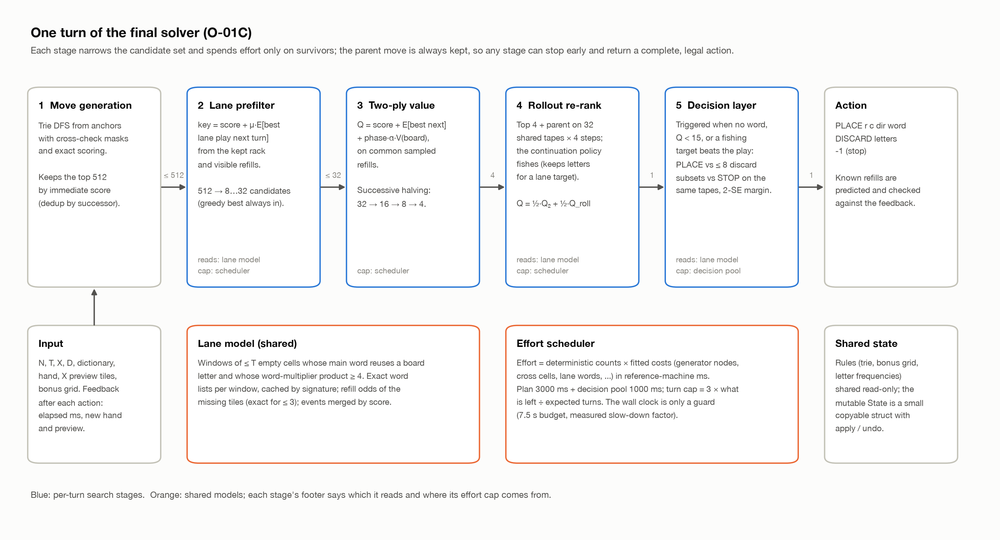

**Figure 2.** One turn of the final solver. Each stage narrows the candidate set and spends effort only on survivors. The greedy best move and the previous stage's choice are always kept, so a stage that runs out of effort returns a complete, legal action.

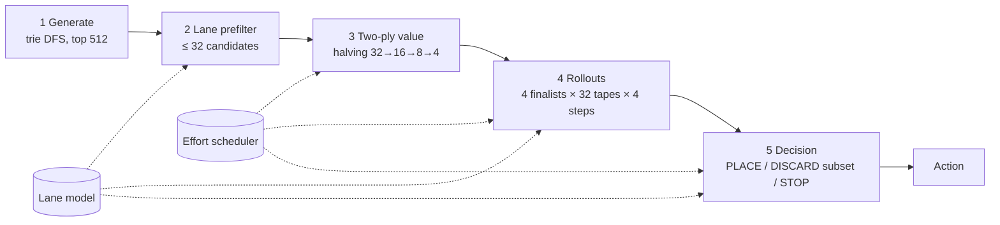

The solver reads the dictionary from standard input, builds a trie (about 110–150 ms), then loops: read the hand and preview, run the pipeline, print an action. Every candidate stage is bounded by an effort cap from the scheduler (§3.7). A separate decision pool funds stage 5.

### 3.2 State, transition and move generation

- **Shared rules, small state.** `Rules` (trie, bonus grid, letter frequencies, word list) is built once and shared read-only through a `shared_ptr`. `State` (board, hand, preview, tiles drawn, score) is a small struct, so search branches copy it freely. A `StateGuard` restores it on scope exit.
- **Transition.** `transition()` applies PLACE, DISCARD or STOP exactly as the official tester does, including the slot order of refills. Unknown refills come from a caller-supplied *tape* of hypothetical letters. The live game never sees a hidden tile: the tape exists only inside simulations. `transition` was diffed against the official Java `placeWord` and refill loop on 1,500 actions and 12,000 apply/undo cycles.
- **Generator.** For every anchor cell and direction, a depth-first search walks the trie. Occupied cells force their letter. Empty cells take the intersection of the trie's children, the remaining rack and a precomputed *cross-check mask* of letters that keep the perpendicular word legal. Scores accumulate incrementally (main word, word-multiplier product, cross words). The generator keeps the top 512 candidates by immediate score, deduplicated by successor state. It was verified against an independent brute-force dictionary enumerator on 1,202 board positions: identical candidate sets and scores. A GADDAG [4] or DAWG [2] would be faster, but generation was never the bottleneck (§8.5).

### 3.3 Two-ply value with common refills (P1-01)

The first real decision rule:

> Q(a) = score(a) + γ · E[best placement score next turn | a],

with γ = 1. Refills inside the visible preview are exact. Beyond it, letters are sampled from the dictionary frequencies. Each turn draws its sampling plan once: S = 4 *common* streams, and every candidate consumes the prefix it needs from the same stream. Comparisons between candidates are therefore paired, which removes most of the sampling noise (common random numbers [6]). Only completed sampling rounds count, so a deadline never favours the candidates that happened to be evaluated first.

### 3.4 The lane model and prefilter (P1-02)

P1-01's logs showed what the two-ply value missed. 65% of placements had a word-multiplier product of 1, while plays with a product of 27 or more, 0.86 per game, earned 23% of all points. Widening the evaluation from K = 32 to 128 candidates helped (+6%) because the extra candidates included *setup* moves: a modest play now that opens a high-product play next turn. Those moves ranked 64–127 by immediate score and earned only 12 points on average themselves, but their expected next-turn score was 314.

The lane model finds them cheaply:

- **Lanes.** A lane is a window of at most T empty cells in one line whose main word would reuse a board letter and whose word-multiplier product is at least 4. The 16 best lanes per board are kept.
- **Exact word lists.** For each lane, the model lists every dictionary word that fits exactly (fixed letters and cross-checks) with its exact score. Lists are cached by the lane's signature across turns.
- **Rack value.** For a kept rack plus visible refills, each word's missing tiles form a multiset. The model computes the chance of drawing them (exact for up to 3 missing tiles), treats words missing the same tiles as one event, and merges events in score order as if independent. The result is the expected best lane play next turn.
- **Prefilter.** The key `score + μ · lane value` selects at most 32 of the 512 generated candidates for stage 3. The greedy best is always included.
- **Board potential.** A per-line dynamic program picks disjoint windows maximising Σ (product − 1) · ρ^(new tiles) · (cross-check letter mass)^τ. Q gains a term `phase · α · V(board)`, where `phase = min(1, tiles left / 2T)` switches it off as the deck runs out.

### 3.5 Successive halving under an effort budget (P2-03)

With the prefilter in place, a fixed per-turn time slice became the bottleneck. On large boards whole evaluation rounds were cut, the solver fell back to the greedy move, and the *same binary* made different moves on different runs. P2-03 replaced both with:

- **Deterministic effort.** Every expensive operation increments a counter (generator nodes, cross-check cells, retained candidates, lane words scanned or built). Counters are multiplied by coefficients fitted by least squares on 9,089 profiled training turns (R² = 0.99 for the second-ply generator), giving predicted nanoseconds on the reference machine (Apple M4). All decisions read this count, never the clock.
- **A game plan.** Each turn may spend `front × (plan left) / (expected decisions left)`, at most half of what is left. Expected decisions come from the tiles used per turn so far.
- **Successive halving [5].** All prefiltered candidates get the first common sample. Each further sample goes only to the better half (32 → 16 → 8 → 4 survivors), so a full schedule costs 60 second-ply evaluations instead of 128.
- **A wall-clock guard only as a safety net.** A measured slow-down factor shrinks the plan when the machine is slower than predicted, and a hard per-turn deadline cancels unfinished rounds.

### 3.6 Rollouts on shared tapes (P2-01) and the decision layer (P1-03)

**Rollouts [7].** The 4 best two-ply candidates plus the current choice are re-ranked by 4-step rollouts. A *tape* is one hypothetical future tile sequence, indexed by absolute draw position, so candidates that use different numbers of tiles still see the same future. All candidates run on the same 32 tapes. The continuation policy sees only the simulated hand and preview, never the tape, so it cannot cheat. The rollout value is mixed half and half with the two-ply Q: `Q = ½ Q₂ + ½ Q_roll`. Pure rollout values were worse, because a 4-step greedy continuation is biased against setups (§6).

**Decision layer.** When there is no legal word, when Q < 15, or when a fishing target looks better than the play (§3.8), a unified comparison runs. It compares the planned placement, up to 8 discard subsets (deduplicated as multisets and prescreened by the lane model's keep value) and STOP (value exactly 0). All are valued on the same tapes with the same continuation policy. A non-parent action must win by two paired standard errors. The layer has its own effort pool (20 ms per decision, 1,000 ms per game) and paces it across expected decisions.

### 3.7 Time as a deterministic resource

The scheduler made the solver reproducible. On the same seed and binary, the action sequence is identical whether the machine is idle or running six other games, as long as the wall-clock guard stays inactive. That turned every A/B comparison into a paired comparison of decisions rather than of timings. The guard is deliberately conservative: it uses at most 85% of the remaining 7.5 s internal budget, and it keeps back enough effort to generate a greedy move on every remaining turn.

The cost is that the plan's size is a parameter, not "whatever time is left". The final plan is 3,000 ms of reference-machine effort plus a 1,000 ms decision pool, against a 10 s limit. On my machine, one game at a time, the final build's median game took 3.2 s (P95 4.2 s, max 4.8 s over 200 seeds).

### 3.8 Fishing (O-01A) and the dominated-STOP guard (O-01C)

An analysis of INT-01's games (§8.3) suggested a blind spot. The rollout continuation always plays the highest-scoring word, so "discard now and wait for the letters of a big lane word" and "play junk now" looked equally good. Fishing changes three things:

- **Fishing continuation (policy 4).** Inside rollouts, at each step the policy compares the best play plus the lane value of the leave with a discard that keeps exactly the letters one target word needs (top 3 targets over the 4 best lanes), valued by `−D + lane value`.
- **Root fishing trigger.** The decision layer also fires when the play earns under 10 points per tile and a concrete target's expected value after a discard beats the play plus D.
- **Paced decision pool.** The pool is spread over expected decisions so that long games do not exhaust it early.

O-01C added fixes to two shared lane-model estimators: stale low events lowering the guaranteed score, and duplicate events crowding the 8-slot summary. It also switched to exact refill probabilities. Its main change was the **dominated-STOP guard**. A 5,000-game release run showed that on X = 0 boards the fishing continuation sometimes valued every placement below zero within its 4-step horizon, so the decision layer chose STOP with most of the deck left. STOP is dominated by "play any legal word, then stop", so O-01C no longer offers STOP when a placement exists. That recovered the 4.5% loss on X = 0 games.

### 3.9 Engineering practices

- **Independent oracles.** A brute-force dictionary enumerator checks the generator. The official Java tester's own methods check the transition. Every deterministic refill the solver predicts is compared with the tester's feedback during real games: zero mismatches in over 100,000 checks across all experiments.
- **Every experiment is a switch.** New behaviour arrives behind a flag that defaults to off. Before any comparison, the build with the flag off must reproduce its parent's action hash on 100 games.
- **Pre-registered gates.** Before a validation run, the experiment's document fixed the metric thresholds, seed sets and stop conditions (§7.2).
- **Frozen, hashed builds.** Every tested binary is stored with its source hash, compiler and tester hashes. A submission package is generated from the frozen source by a script that asserts the hash.
- **Post-match refactor.** The 2,300-line single file was split into 15 modules (§Appendix A) after the match. Golden action traces captured from the pre-refactor binary and from the submitted package prove that the refactor did not change behaviour.

---

## 4. Development timeline

**Table 2.** Development phases and provisional readings (0–100, 100 cases).

| Date (PDT) | Phase | Reading |
|---|---|---|
| 11 Oct 01:23 | B0: trie greedy, whole-hand discard when no word | 26.63 (rank 52) |
| 11 Oct | P0: diagnostics, candidate interface, exact state simulation | — |
| 11 Oct 21:40 | P1-01: two-ply lookahead | 31.13 |
| 11–12 Oct | P1-02: lane prefilter and board potential (not submitted on its own) | — |
| 12 Oct 07:42 | P2-03: effort scheduler, successive halving, pool 512 | 35.43 (rank 38) |
| 12 Oct | P2-01 rollouts and P1-03 decision layer, each failing one gate alone | — |
| 12 Oct 16:01 | INT-01: both together with a pacing fix | 37.04, later 36.97 |
| 13 Oct morning | O-01A: fishing | 36.07 |
| 13 Oct afternoon | O-01C: estimator fixes and dominated-STOP guard | 36.07 |
| 13 Oct 20:23 | O-01C with a reduced time or effort budget (final) | 36.47 → **final 40.57, rank 41** |

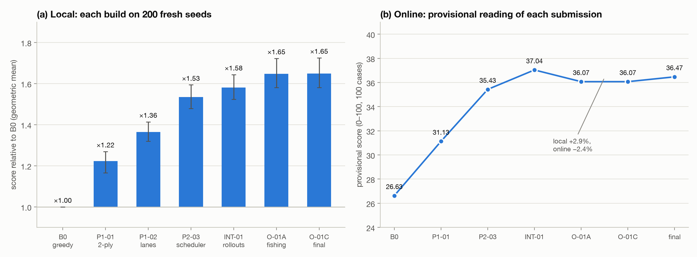

**Figure 3.** (a) Each build re-run for this report on 200 fresh seeds (30001–30200), relative to the greedy baseline B0; bars are geometric means with bootstrap 95% intervals. (b) The provisional reading of each submission. The online curve tracks the local one up to INT-01 and then turns down while the local curve keeps rising.

---

## 5. What shipped, and why it worked

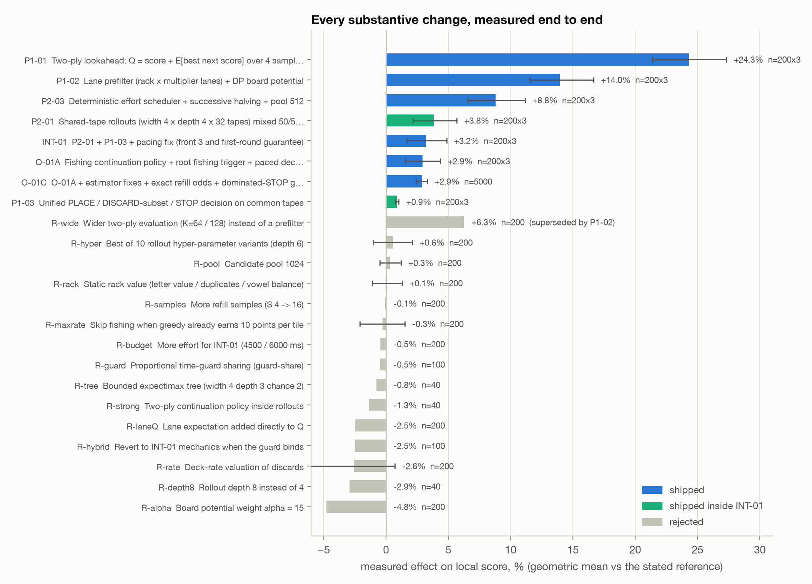

**Figure 4.** Every substantive change, measured end to end on the local tester against the build it was meant to replace. "n = 200×3" means 200 validation seeds × 3 strategy RNG seeds, averaged per seed before the bootstrap. Rejected changes were measured on training seeds.

### 5.1 Two-ply lookahead (+24.3%)

Sampling turned out to matter more than the visible preview. Using only the deterministic preview, with no sampled refills, gained just 1.6%. The full version with 4 sampled streams gained 24.3% on validation, winning 193 of 200 seeds. Width K was the dominant parameter: K = 8 < 16 < 32, monotone. More samples per candidate did not help.

### 5.2 Lane prefilter and board potential (+14.0%)

Ablations on training seeds attributed +8.5% to the prefilter, +3.8% to the board potential and +1.8% to treating lane multipliers as a product rather than a sum. Mechanism counts confirmed the target. Plays with a product of 27 or more rose from 0.86 to 1.20 per game, and their points from 466 to 823, which accounts for essentially the whole gain. Discards did not change.

### 5.3 Deterministic scheduler and successive halving (+8.8%)

The scheduler alone (removing wall-clock truncation) was worth about 1%, and successive halving freed a third of the second-ply work. The surprise was where the freed effort paid: not in more width or more samples (both flat within noise), but in a wider candidate pool. Pool 128 → 512 added 8%. P1-02 had found pool 256 no better only because the bigger pool had pushed more turns past the wall-clock slice. A budget curve (Figure 7a) showed the two-ply evaluation saturating at 1–1.5 s of effort per game. The shipped 800 ms was the largest budget whose runtime tail did not exceed the parent's.

### 5.4 Rollouts and the decision layer, integrated (+3.2%)

Each failed one pre-registered gate on its own. Rollouts gained 3.8% at equal budget but completed their first fair round on only 91% of turns on N = 20 stress boards (gate: 95%). The cause was pacing: a front-loaded plan spent the 3,000 ms by mid-game and starved the second half. The decision layer gained only 0.9% against a 2% gate. Almost all of that came from STOP, which avoids paying discard penalties at the end of a game with no future, and selective keeping gave nothing measurable. Integrated with a pacing fix (front 6 → 3, plus a guaranteed first rollout round), INT-01 passed all 32 gates on a never-used validation set: +3.2% at equal budget and +3.7% over the shipped P2-03, with 99.9% stress completion.

### 5.5 Fishing and its fixes (+2.9% locally, −2.4% online)

A mechanism experiment came first. In 40 early-game states where the fishing policy wanted to discard, a targeted discard followed by fishing beat a greedy play followed by greedy play by **+458 points per state** on 16 common tapes each (39 of 40 states won). That is a large effect: about 15–20% of a typical game's score from a single decision. As a full-game change, O-01A gained 2.9% (validation, 3 RNG seeds). On a fresh audit set it gained 4.0% against INT-01, and O-01C gained 2.9% over 5,000 games. Online, O-01A and O-01C each read about 0.9 points *below* INT-01 (§7.4).

---

## 6. Negative results

**Table 3.** Rejected changes, each measured end to end.

| Change | Idea | Result | Why it failed |
|---|---|---|---|
| Wider two-ply (K 64/128) | Evaluate more candidates directly | +6.3% vs P1-01 | Superseded: the prefilter reaches the same setup moves at a fraction of the cost |
| More refill samples (S 4 → 16) | Less sampling noise | −0.1% | Common random numbers had already removed the noise that mattered |
| Static rack value | Letter values, duplicate and vowel-balance penalties | +0.1% [−1.1, +1.3] | Hand-made leave heuristics carried no information the two-ply value lacked |
| Lane value added to Q | Reward lane potential directly | −1.0%, −2.5%, −9.0% (λ = 0.5/1/2) | Double counts what the sampled next-turn value already contains |
| Board potential α = 15 | Value open multipliers more | −4.8% | The solver hoards multipliers instead of cashing them |
| Bounded expectimax tree | Width 4, depth 3, 2 chance samples per node | −0.8%, 51% completion | Too expensive per decision; could not finish within budget |
| Rollout depth 8 | Longer horizon | −2.9% | A greedy continuation's bias grows with depth |
| Two-ply policy inside rollouts | Stronger continuation | −1.3% | Fewer tapes per budget; noise outweighed the better policy |
| Deck-rate valuation of discards | Charge each action for the tiles it draws | −2.6% | Penalised fishing exactly where it paid |
| More effort for INT-01 (4,500 / 6,000 ms) | Use more of the 10 s | −0.5%, −0.3% | The evaluation had saturated (§8.5) |
| Candidate pool 1,024 | More candidates | +0.3% [−0.5, +1.2] | Same |
| Ten rollout hyper-parameter variants | Mix, width, depth, tail, share, trigger | best +0.6% [−1.0, +2.1] | Same |
| Proportional time-guard sharing | Keep the decision pool alive on slow machines | −0.5% to +0.4% | Noise; the gain from fishing did not depend on the pool |
| Revert to INT-01 mechanics when the guard binds | Hedge against a slow grader | −2.5% on efficiency cores | The full mechanics stayed better even when starved |
| Skip fishing above 10 points per tile | Save effort | −0.3% | The skipped decisions were the useful ones |

Three patterns cover most of these:

1. **The evaluation saturated before the compute did.** Every "more of the same" change (width, samples, pool, effort, rollout length) was flat or negative once the matching stage existed. The limit was what the value function could see, not how many times it was evaluated.
2. **Short-horizon greedy continuations are biased against plans.** Deeper greedy rollouts, pure rollout values and rate-based discard valuations all lost, for the same reason: they cannot represent "spend tiles now, cash a big word later".
3. **Hand-written heuristics on the rack did nothing; models of the board did a lot.** Static leave values gained 0.1%, while the lane model, which ties a rack to specific multiplier windows, was the second-largest gain of the project.

---

## 7. Evaluation methodology

### 7.1 The main metric

Raw scores vary over two orders of magnitude between cases (a few hundred points on a sparse 10×10 board, over 10,000 on a dense 20×20). An arithmetic mean is dominated by a handful of dense cases. I used the **paired geometric mean of score ratios**,

  G = exp(mean(log((c_i + 1) / (r_i + 1)))),

over seeds i, with a 10,000-sample paired bootstrap for the 95% interval, plus win/loss counts, the 10th-percentile ratio and the share of seeds with a ratio below 0.8. G approximates the official per-case relative scoring better than a mean does, but it is not the official formula: the official MAX is another competitor's score, unknown locally.

### 7.2 Protocol

- **Seed sets.** Regression 1–100; training 101–300; validation 1001–1200, used five times and then retired; fresh validation sets 2001–2200, 3001–3200 and 4001–4200, each used once; a 32-cell stress matrix (N, T, X, D, B at their extremes) × 10 seeds; release stability set 20001–25000. Strategy decisions used training seeds only.
- **Three strategy RNG seeds** per validation, averaged per instance before the bootstrap, so a candidate cannot win on a lucky sampling stream.
- **Gates fixed in advance** in each experiment's plan, including: G above a threshold with the 95% lower bound above 1; all three RNG seeds ≥ 1; P10 ≥ 0.85; severe regressions ≤ 5%; every natural parameter group with ≥ 20 cases at G ≥ 0.97; ≥ 95% completion of the first fair comparison round on validation *and* stress; zero failures; runtime P95 ≤ 6 s and max ≤ 8 s; peak memory ≤ 800 MiB; and action-hash equivalence when switched off. Twice a candidate passed on score and failed on completion (P2-01 at 91.2%, O-01A dev1 at 92.3%); both were fixed in a new, separately registered version rather than by relaxing the gate.

### 7.3 Pitfalls the protocol caught

| Pitfall | Evidence | Rule adopted |
|---|---|---|
| Wall-clock budgets make runs non-reproducible | P1-02: the same binary produced 3 different games on one seed; a P1-01 validation rerun gave G = 0.998 with single-seed ratios as low as 0.60 | Budget in deterministic effort; the wall clock only as a guard |
| Parallel runs perturb wall-clock behaviour | 4 of 820 games diverged under load in P0-02 | Repository-wide lock on benchmark runs; parallel runs only for deterministic builds |
| A harness error looks like a solver error | The dictionary word ERROR matched the failure regex | Parse the tester's real error lines only |
| Output files overwrote each other | `with_suffix` turned `B0.1` and `B0.5` into the same file | Always append extensions |
| A gate can be checked incompletely | P2-01's suite checker verified legality but not stress completion | Every gate is a line in a machine-checked JSON |
| Single-RNG results overstate | P2-01 8-sample: +3.6% on RNG 167, +0.0% on RNG 2027 | Three RNG seeds before any claim |

### 7.4 Where the protocol did not predict the leaderboard

Up to INT-01, every local gain showed up online in the same direction. After that, the online readings went down while the local ones went up:

| Build | Local vs INT-01 | Online vs INT-01 (36.97) |
|---|---|---|
| O-01A | +2.9% [1.5, 4.4] (600 games); +4.0% on a fresh audit set (200 games) | 36.07 (−2.4%) |
| O-01C | +2.9% [2.4, 3.3] (5,000 games) | 36.07 (−2.4%) |
| O-01C time probe (final) | 0.5–8.9% below O-01C locally (§8.2) | 36.47 (−1.4%) |

What was tested and ruled out (or not):

- **A slower grader.** Simulated 2–4× slow machines (stretching the generator or whole turns) kept O-01A ahead of INT-01 by 1.3–2.6%, even when the decision pool was fully starved. A real 3–4× slower machine (efficiency cores) also kept the newer build ahead.
- **Compiler and memory effects.** Pattern-initialised memory, malloc scribbling, g++-16 with libstdc++ and clang without FMA contraction all produced identical actions on 40 seeds.
- **Timeouts.** The time-limit probes were submitted to test this. The last one read 36.47, still below INT-01, so a timeout is unlikely to explain the whole gap.
- **Not ruled out.** The provisional sample is 100 cases, and the score is relative to a moving MAX. A build that gains on cases where other competitors are much stronger gains little after normalisation (a two-case counterexample shows the order can flip). Local 100-case resamples put the chance of a −2.4% reading under +2.9% true gain below 1%, but that assumes the local distribution matches the grader's.

The final score supports one modest reading: whatever the cause, the last submission did not collapse on 5,000 cases. Its final score of 40.57 rose by about 4.1 points from provisional, in line with the field (§8.1). I cannot tell whether INT-01 would have scored higher in the final, because only the last submission is scored.

---

## 8. Results

### 8.1 Leaderboard

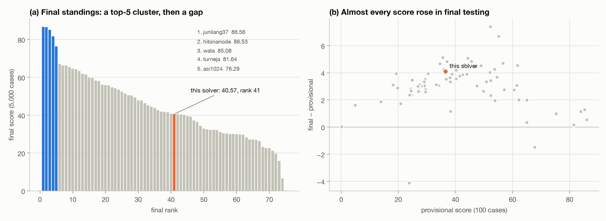

**Figure 9.** (a) Final scores of the 75 competitors with a non-zero score. (b) Final minus provisional score. Most of the field gained 2–5 points in final testing, presumably because the per-case MAX values were lower over the 5,000 final cases; the gain is a normalisation effect, not a change of code.

| | Score |
|---|---|
| Baseline B0 (11 Oct) | 26.63 provisional |
| Best provisional reading (INT-01, 12 Oct) | 37.04 |
| Final submission, provisional | 36.47 (rank 42) |
| **Final submission, final test** | **40.57 (rank 41 of 79)** |
| Winners (junliang37, hitonanode) | 86.56, 86.53 |
| Rank 5 (asi1024) / rank 6 (simanman) | 76.29 / 67.02 |

The top five form a separate cluster: 76–87, then a 9-point gap to 67, followed by a smooth decline. A gap like that usually means a qualitatively different approach, not better tuning of the common one.

### 8.2 The lineage on fresh seeds

For this report every submitted build was re-run on 200 seeds never used before (30001–30200), on the official tester with the 10 s limit, six games in parallel.

**Table 4.** All builds on seeds 30001–30200.

| Build | Mean | Median | G vs B0 | G vs O-01C | Runtime P50 / P95 / max (ms) | Guard turns | Same actions as O-01C |
|---|---|---|---|---|---|---|---|
| B0 greedy | 1,645 | 1,279 | 1.000 | 0.606 | 22 / 47 / 68 | 0 | 0 |
| P1-01 two-ply | 2,102 | 1,566 | 1.223 | 0.741 | 316 / 999 / 1,459 | 0 | 0 |
| P1-02 lane prefilter | 2,362 | 1,691 | 1.365 | 0.827 | 427 / 1,178 / 1,896 | 0 | 0 |
| P2-03 scheduler | 2,836 | 1,826 | 1.534 | 0.930 | 425 / 1,196 / 1,413 | 0 | 0 |
| INT-01 rollouts + decision | 2,928 | 1,936 | 1.580 | 0.958 | 3,145 / 4,568 / 5,021 | 13 | 2 |
| O-01A fishing | 3,093 | 2,034 | 1.647 | 0.999 | 4,179 / 5,454 / 6,345 | 23 | 64 |
| **O-01C (final, base)** | **3,073** | **2,069** | **1.649** | **1.000** | 4,203 / 5,492 / 6,767 | 81 | 200 |
| O-01C, serial | 3,073 | 2,069 | 1.650 | 1.000 | 3,153 / 4,183 / 4,820 | 0 | 191 |
| O-01C, work 2,000 ms | 2,963 | 2,074 | 1.623 | 0.984 | 3,036 / 4,036 / 4,893 | 0 | 52 |
| O-01C, work 1,500 ms | 2,874 | 1,943 | 1.585 | 0.961 | 2,429 / 3,189 / 3,835 | 0 | 32 |
| O-01C, work 1,000 ms | 2,773 | 1,961 | 1.549 | 0.939 | 1,740 / 2,236 / 3,137 | 0 | 16 |
| O-01C, work 700 ms | 2,610 | 1,844 | 1.503 | 0.911 | 1,289 / 1,646 / 1,783 | 0 | 4 |
| O-01C, wall 5.0 s, serial | 3,071 | 2,015 | 1.643 | 0.996 | 3,151 / 4,139 / 4,512 | 532 | 148 |
| O-01C, wall 3.0 s, serial | 2,900 | 1,957 | 1.574 | 0.954 | 2,650 / 2,823 / 2,856 | 14,247 | 5 |
| Refactored code, O-01C flags | 3,082 | 2,069 | 1.651 | 1.001 | 4,076 / 5,344 / 6,528 | 42 | 189 |

No game failed. G is the paired geometric mean over the same 200 seeds; runtimes are the tester's, measured with six games in parallel, so they run about a third slower than a serial run. The G of the serial rows is taken against the serial O-01C run. "Guard turns" counts turns, summed over the 200 games, in which the wall-clock guard shrank the plan. Only then can load change a decision. The two wall-clock-budget probes and O-01C itself were therefore re-run one game at a time (rows marked "serial"; `serial_probes.csv`).

Four things stand out. The final build is **1.65×** the greedy baseline on fresh seeds, with every stage contributing in the order it was built. O-01A and O-01C are indistinguishable here (G 0.999), consistent with the dominated-STOP guard mattering mainly on X = 0 boards (§3.8). Every reduced-budget probe scores below O-01C, from −0.5% (wall 5 s) to −8.9% (work 700). The serial O-01C run repeats the parallel one exactly on the 191 games where neither engaged the guard. And the refactored code reproduces the submitted O-01C package: identical action sequences on 189 of 200 games in the parallel run, and on the remaining 11, where the guard had engaged in one binary or the other, identical sequences for both when re-run one game at a time. That makes 200 of 200.

### 8.3 Anatomy of a game


**Figure 1.** Seed 30159 (N = 14, T = 8, X = 4, D = 1), the median-scoring game with N between 13 and 15 in the fresh run. (a) The final board. Tinted cells are multipliers, and a placed tile keeps its cell's tint as a border. The black box is the best play, PINKIES, for 392 points at a word-multiplier product of ×16. (b) Cumulative score against tiles placed. The three best plays carry 43% of the 1,658 points; after the first 40 tiles the score grows in small steps, as the board congests.

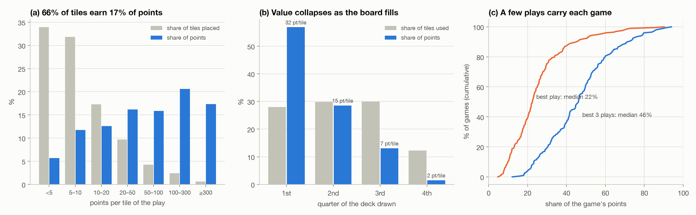

**Figure 5.** The final build on seeds 30001–30200. (a) Points per tile of each play: share of all placed tiles against share of all points. (b) Points by quarter of the deck drawn. (c) Cumulative distribution over games of the share of points earned by the best play and by the best three plays.

The anatomy of the final build's games, against the greedy baseline B0 on the same seeds:

| Per game (mean over 200 seeds) | B0 | Final (O-01C) |
|---|---|---|
| Score | 1,645 | 3,073 |
| Plays / tiles placed | 61.8 / 165.9 | 62.5 / 166.4 |
| Discard actions / tiles discarded | 9.5 / 64.6 (27% of the deck) | 4.6 / 27.6 (13%) |
| Plays with product ≥ ×27: count / points | 0.41 / 213 | **1.50 / 1,489** |
| Plays with product ×9–26: count / points | 2.83 / 365 | 2.96 / 571 |
| Plays with product ×1: count / points | 39.6 / 434 | 43.2 / 450 |
| Best play's share of points (median) | 11% | 22% |
| Best three plays' share (median) | 24% | 46% |
| Points per tile by deck quarter | 14.9 / 9.3 / 4.9 / 0.5 | 32.3 / 15.2 / 6.9 / 1.9 |
| Games ending by STOP / by no legal move | 0 / 199 | 159 / 40 |

- **The whole gain over greedy is in the jackpots.** The final build places the same number of tiles in almost the same number of plays. Plays with a product of ×27 or more went from 0.41 to 1.50 per game and from 213 to 1,489 points: 1,276 of the 1,429 extra points. Everything else is roughly unchanged.
- **Tiles are spent badly after the opening.** 66% of placed tiles earn under 10 points each and together make 17% of the score. 7% of tiles, in plays worth 50 or more points per tile, make 54%.
- **The board congests.** The first quarter of the deck earns 32 points per tile, the second 15, the third 7. Most games now end by choosing STOP once no legal word remains, with about a sixth of the deck unused.

### 8.4 Where the multipliers and letters go

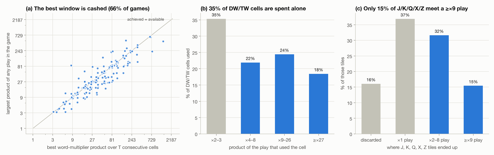

**Figure 6.** (a) For each game, the best word-multiplier product over any T consecutive cells of the board against the largest product the solver achieved; points above the diagonal thread existing letters to span more multipliers. (b) Every double- or triple-word cell the solver used, by the product of the play that used it. (c) Where the J, K, Q, X and Z tiles ended up.

Figure 6 tests three versions of "the board offers more than the solver cashes":

- **The single best window is cashed.** Over T consecutive cells, the best word-multiplier product on the board has a median of ×34; the solver's largest play reaches it in 66% of games (B0: 15%), and some plays exceed it by threading existing letters. Missing the board's best window is not the problem.
- **Multiplier cells are spent cheaply.** 35% of all DW/TW cells the solver uses go into plays whose total product is only ×2 or ×3, a single multiplier on its own. Each of those cells could instead have been one factor of a ×9 to ×81 play.
- **The valuable letters rarely meet the multipliers.** Of the J, K, Q, X and Z tiles, 16% are discarded and 37% are played in ×1 plays; only 15% end up in a play with a product of ×9 or more. A Q or Z on a triple-letter cell inside a ×27 word is worth 810 points from that tile alone.

The solver cashes the obvious jackpot well. It does not *build* the next one: it neither protects multiplier cells for later combination nor holds the letters that would make a jackpot large.

### 8.5 Time and effort

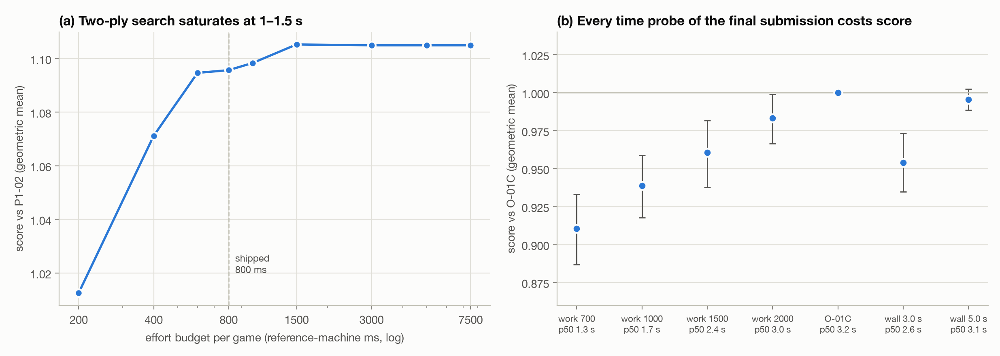

**Figure 7.** (a) The P2-03 budget curve on training seeds: the two-ply evaluation stops improving at about 1.5 s of reference-machine effort. (b) The final submission's six time-limit probes on seeds 30001–30200, relative to O-01C run one game at a time, with median runtimes (serial for O-01C and the wall-clock probes; from the six-way parallel run, about a third slower, for the work probes). Reducing the budget always costs score; the evaluation saturates near the shipped 3,000 ms.

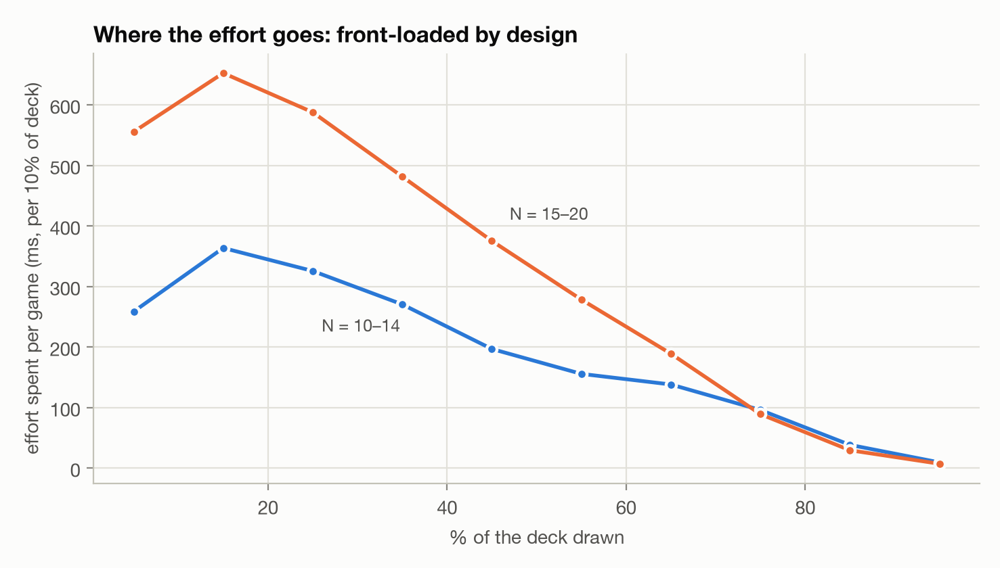

**Figure 8.** Effort spent per game in each tenth of the deck, final build. The scheduler front-loads by design (the turn cap is three times the even share), and the late game, where few legal moves remain, costs almost nothing.

The final build spends a mean of 2.6 s of reference-machine effort per game, 54% of it in the first 30% of the deck; the first quarter alone scores 57% of the points. The design is sound for this value function. Figure 7 shows its limit: halving the effort costs 4–6%, but INT-01 gained nothing from 50% or 100% *more* effort (§6), so this evaluation could not have used the remaining six seconds.

### 8.6 Parameters

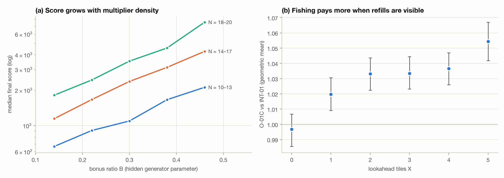

**Figure 10.** The 5,000-game release run (seeds 20001–25000). (a) Median final-build score by bonus ratio B for three board-size groups (log scale). (b) O-01C against INT-01 by preview length X, with 95% intervals.

Two properties of the case generator matter. **Score scales with multiplier density at least as much as with board size** (Figure 10a): at a fixed board size, moving from B < 0.18 to B > 0.42 multiplies the median score by 3.2 (N = 10–13) to 4.2 (N = 18–20), while moving from the smallest to the largest boards, with 2.7× as many tiles, multiplies it by about 2.7. That is the multiplicative stacking of §2.2 at work, and it makes high-B cases the ones where a jackpot planner gains most in absolute points. **Fishing needs the preview** (Figure 10b): O-01C's gain over INT-01 rises steadily from −0.3% at X = 0 (no preview) to +5.4% at X = 5, because a fishing decision is only as good as its knowledge of the next refills.

---

## 9. The gap to the top: what the leaders probably did

The leaders' code is not public, so this section is an inference from the score's structure and from my own measurements. It should be read as a hypothesis with evidence, not a description.

**How large is the gap?** A final score of 40.57 means the solver's raw score averaged about 41% of the best raw score on each case. The winners averaged 87%. On a typical case the leaders therefore scored roughly **twice** this solver's raw score. A gap that size does not come from tuning. It needs a different allocation of the game's two scarce resources: the N² tiles and the board's multiplier cells.

**Where a factor of two can come from.** The anatomy of §8.3–8.4 gives three concrete sources; the first alone is the size of the gap:

1. **The deck after the opening.** If every placed tile earned what the first quarter of the deck earns (32 points per tile), the final build's games would score **2.0×** as much. That is not a bound; a perfectly open board does not exist. But it shows that keeping the board able to absorb tiles at a high rate is worth a factor of two by itself. The solver instead spends 66% of its tiles at under 10 points.
2. **Multiplier cells used one at a time.** 35% of the DW/TW cells go into ×2–3 plays. Moving even a third of them into ×9+ plays would add on the order of one more jackpot per game, worth about 1,000 points against a mean game of 3,073.
3. **Letters.** Only 15% of the J/K/Q/X/Z tiles meet a ×9+ play. Each such tile adds 45–270 points to a ×9–27 word (K at ×9 to Q or Z at ×27) instead of 5–10 in a plain play.

There is also direct evidence that the policy needed is learnable and pays. In the O-01A mechanism experiment (§5.5), keeping the letters a target word needs, discarding the rest and continuing to fish beat playing greedily by **458 points per decision** in early-game states. Yet the full-game gain of O-01A was only 3%, because its root trigger fires on weak plays only and its rollouts see 4 steps ahead.

**The most likely structure of a top solver.** Putting these together, I would expect the top five to share most of the following:

1. **Explicit jackpot targets.** Enumerate line segments that cross two or more word multipliers and can be anchored, and the word families that fit them, with exact scores including letter multipliers. A ×27 lane with a 10-point letter on a TL is worth thousands of points.
2. **Long-horizon fishing for those targets.** Keep the letters a target needs, discard the rest (at most 5 points per discard, regardless of count), and use the X-tile preview to time the cash-in. My mechanism experiment measured +458 points per decision for exactly this behaviour, but the 4-step horizon and root triggers of my architecture realised only a fraction of it.
3. **Board stewardship.** Treat each unused DW/TW cell as an asset with a shadow price. Play filler words where they do not burn multipliers or block lanes, or discard instead of playing junk into a jackpot lane.
4. **The whole time budget on plan evaluation.** Monte Carlo over sampled decks to decide when to cash and which target to abandon, rather than more width on a myopic evaluation. My budget experiments say more of *my* evaluation would not help; they do not say more time cannot help.
5. **Values learned offline.** Leave values, multiplier-cell prices and target hit rates fitted by millions of self-play games, as championship Scrabble programs do with rack-leave tables [3]. My hand-written rack heuristic gained nothing (§6), which suggests the signal needs to be learned, not guessed.

---

## 10. If I started again: a redesign

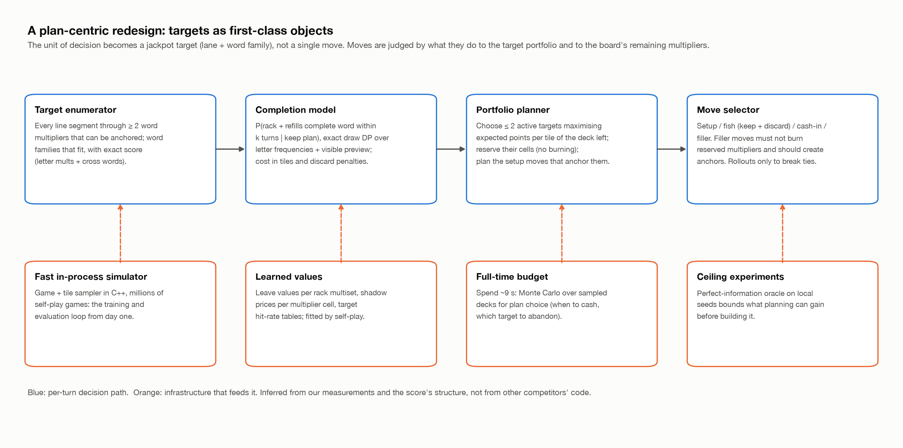

**Figure 11.** A plan-centric architecture. The unit of decision is a jackpot target, not a move; moves are judged by what they do to the target portfolio and to the board's remaining multipliers.

**What I would change from day one.**

1. **Measure the score's anatomy before choosing an algorithm.** The analysis behind Figures 5 and 6 needs only a baseline's logs and an hour, and the greedy baseline already shows the same collapse (15 points per tile in the first quarter of the deck, 0.5 in the last). Had I made it on the first evening, they would have pointed at jackpots, tiles and multiplier cells as the whole game. My Marathon Match 166 write-up drew the same lesson, "derive what an ideal solution looks like before choosing an algorithm", and I did not apply it here under time pressure.
2. **Make the target, not the move, the unit of planning.** The lane model (§3.4) was already most of a target enumerator. In this design it becomes the centre: a portfolio of at most two active targets, a completion model using exact draw probabilities, and a move selector with four modes (setup, fish, cash, filler) whose filler mode refuses to burn reserved cells.
3. **Build the self-play simulator first.** The Java-free deterministic driver (`tests/selfplay.py`) and the in-process `transition()` existed, but only as test infrastructure. As the training loop, a C++ simulator playing thousands of games per minute would have let me fit leave values and cell prices instead of hand-tuning α, ρ, κ and τ.
4. **Run ceiling experiments.** A local oracle that knows the full tile sequence bounds how much any planning can gain. I never ran one, so I could never say whether the remaining gap was in planning or in move generation.
5. **Keep the parts that worked.** Deterministic effort accounting, common random numbers, independent oracles, golden traces and frozen hashed builds all paid for themselves. They belong in the new design unchanged.
6. **Use a lighter protocol while exploring.** Thirty-two gates per candidate is the right bar for a submission, and too heavy for asking whether a direction has any signal. I would use quick 40-seed screens to explore and keep the full protocol for shipping.

---

## 11. Lessons

1. **Find the jackpot structure first.** When a score multiplies, a few events dominate, and the solver must plan for them rather than discover them.
2. **Saturation is a signal.** When width, samples, pool size and time all stop helping at once, the value function is the bottleneck, not the search.
3. **Short-horizon greedy rollouts cannot value waiting.** Any game where spending resources now enables a large payoff later needs a model of the payoff, not a longer greedy simulation.
4. **Budget compute in deterministic units.** It turned a noisy, load-dependent solver into a reproducible one and made every comparison a paired comparison of decisions.
5. **Know what each signal can see.** 600 local games could not predict a 100-case provisional reading after INT-01. Decide in advance which signal settles which question.
6. **Write negative results down with their numbers.** Fifteen rejected changes form most of this report's evidence about where the ceiling is.

---

## 12. Threats to validity

- **Hardware.** All local runs used one Apple M4 machine; the grader's hardware is unknown.
- **Historical numbers.** Effects in §5–7 come from the development log, each measured against the build current at the time on the stated seeds. §8.2–8.5 and Figures 1, 3a, 5, 6, 7b and 8 come from runs made for this report; Figure 10 re-analyses the 5,000-game release run made during the match.
- **Parallel runs.** The 200-seed lineage run used six parallel games. Builds budgeted in effort units are unaffected unless the wall-clock guard engages; Table 4 reports how often it did, and the wall-clock-budget probes were re-run serially.
- **Provisional scores** cover 100 cases and are relative to a moving field. The final score covers 5,000 cases but only for the last submission.
- **Which probe was submitted last** is not recorded in the development log, so the final submission is identified only as one of the six O-01C time-limit probes (§8.5).
- **The leaders' approach** (§9) is inferred from the score's structure, not from their code.

---

## 13. Conclusion

I built a correct, reproducible and carefully measured C++ solver for a one-player word game and improved it from 26.6 to a best provisional reading of 37.0 and a final score of 40.57 (rank 41 of 79). The engineering held up: zero failed games in tens of thousands of local runs, deterministic effort accounting and independent oracles for every rule. The ceiling came from the value function. A pipeline of increasingly expensive move evaluations saturated at about a second of compute, because none of its stages could represent the plan that the score rewards most: keep the right letters, keep the multiplier lanes open, and cash a few very large words. The leaders, at roughly twice the raw score, almost certainly planned for those words explicitly.

---

## Acknowledgements and tooling

Development used an AI coding assistant (Claude) for implementation, experiment scripts, analysis and review. Design decisions, experiment selection and submission decisions were my own. The problem statement, the offline tester and the dictionary distribution are TopCoder's.

## References

1. TopCoder. *Marathon Match 167: WordGame*, October 2026. https://www.topcoder.com/challenges/0b11e0fd-3e2d-46dc-8f7b-27c9f49d63cb
2. Appel, A. W., & Jacobson, G. J. (1988). The world's fastest Scrabble program. *Communications of the ACM*, 31(5), 572–578.
3. Sheppard, B. (2002). World-championship-caliber Scrabble. *Artificial Intelligence*, 134(1–2), 241–275.
4. Gordon, S. A. (1994). A faster Scrabble move generation algorithm. *Software: Practice and Experience*, 24(2), 219–232.
5. Jamieson, K., & Talwalkar, A. (2016). Non-stochastic best arm identification and hyperparameter optimization. In *AISTATS 2016*, 240–248. (Successive halving.)
6. Glasserman, P., & Yao, D. D. (1992). Some guidelines and guarantees for common random numbers. *Management Science*, 38(6), 884–908.
7. Tesauro, G., & Galperin, G. R. (1996). On-line policy improvement using Monte-Carlo search. In *NIPS 9*, 1068–1074. (Rollouts.)

---

## Appendix A. Repository map

Paths are relative to the `tc_marathon_167/` directory of this repository.

| Path | Contents |
|---|---|
| `src/WordGame.cpp` | Unity translation unit: includes every module below |
| `src/game.*`, `trie.h`, `common.h` | Rules, State, actions, input protocol, dictionary trie |
| `src/transition.*`, `scoring.*` | Exact state transition on a tape; independent move validation and scoring |
| `src/generator.*` | Trie move generator with cross-check masks and a top-K pool (§3.2) |
| `src/evaluate.*`, `lane_model.*` | Evaluation configuration, board potential, the lane model (§3.4) |
| `src/lookahead.*`, `scheduled.*`, `cost_model.*` | Prefilter, two-ply value, successive halving, effort costs (§3.3, §3.5) |
| `src/deep.*`, `fishing.*`, `discard.*` | Rollouts on shared tapes, fishing policy, the decision layer (§3.6, §3.8) |
| `src/options.*`, `driver.*`, `main.cpp` | Command line and presets; the game loop with scheduling and diagnostics |
| `tests/*_test.cpp` | C++ unit tests: brute-force generator oracle, simulation, rollouts, discards, fishing |
| `tests/selfplay.py`, `test_golden.py`, `golden/` | Java-free deterministic game driver; golden action traces |
| `scripts/bundle.py` | Single-file submission bundle (`dist/WordGame.cpp`, `.zip`) |
| `scripts/run_tester.py` | Run the official tester over seeds, CSV out |
| `report/` | This report, its figures, the data behind them, `extract_runs.py` (tester runs → data) and `make_figures.py` (data → figures) |

## Appendix B. Reproducing the results

```bash
cd tc_marathon_167
make build && make test       # tools/enable2k.txt enables the golden-trace tests
# Put TopCoder's tester.jar and enable2k.txt in tools/ (see tools/README.md).

# The final build (O-01C) on the fresh seeds of §8, with per-turn diagnostics
mkdir -p runs
python3 scripts/run_tester.py --exe build/WordGame --seeds 30001:30200 --jobs 4 \
    --args="--diagnostics" --save runs/o01c > runs/o01c.csv
# Other builds: --args="--preset int-01 --diagnostics", "--preset p2-03 ...", etc.
# A time-limit probe:   --args="--work-ms 1500 --discard-work-ms 500 --diagnostics"
# Name each run after a build in report/extract_runs.py (B0 = "--preset p2-03 --no-lookahead").

python3 report/extract_runs.py runs report/data   # per-game anatomy and lineage tables
python3 report/make_figures.py                    # rebuilds report/figures/*.png from report/data/
```

`report/data/` holds every number plotted:

- `lineage.csv`, `lineage_seeds.csv`: every submitted build on seeds 30001–30200 (official tester, 10 s limit, six games in parallel), summary and per seed;
- `anatomy_final.csv`, `anatomy_b0.csv`: per-game anatomy of the final build and of the greedy baseline (plays, tiles, discards, best plays, multiplier products, points and tiles by deck quarter);
- `per_tile_*.csv`, `product_*.csv`, `multiplier_cells_final.csv`, `rare_letters_final.csv`, `effort_final.csv`: the play-level aggregates behind Figures 5, 6 and 8;
- `board_final.json`: the game drawn in Figure 1;
- `serial_probes.csv`: the wall-clock-budget probes and O-01C re-run one game at a time;
- `final5000.csv`: INT-01, O-01B and O-01C on the 5,000-seed release set 20001–25000;
- `leaderboard.csv`: the final standings page, parsed;
- `submissions.csv`, `changes.csv`, `budget_curve.csv`: transcribed from the development log.

The per-game numbers were extracted from the solver's `--diagnostics` lines by replaying each game's actions on the bonus grid. Fresh runs reproduce the effort-budgeted builds exactly unless the wall-clock guard engages; the `guard_turns` column of `lineage.csv` counts how often it did.

## Appendix C. Glossary

| Term | Meaning |
|---|---|
| Lane | A window of ≤ T empty cells in one line whose main word reuses a board letter and whose word-multiplier product is ≥ 4 |
| Product | The product of the DW (×2) and TW (×3) multipliers under a play's newly placed tiles |
| Tape | A hypothetical future tile sequence, indexed by absolute draw position, shared by all candidates |
| Common random numbers | Evaluating all candidates on the same sampled futures so that their differences are paired |
| Effort | Predicted reference-machine time from deterministic operation counts (§3.5) |
| Fishing | Discarding to draw the letters of a specific high-value lane word |
| G | Paired geometric mean of (candidate + 1) / (reference + 1) over seeds |
| First fair round | The first rollout or decision round in which every candidate received the same complete sample |
| Provisional / final score | Leaderboard score on 100 cases during the match / on 5,000 cases after it, both 0–100 relative to the best competitor per case |
